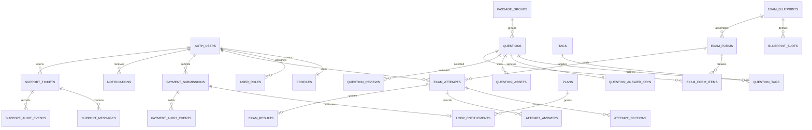

# Logical data model

`AUTH_USERS` is managed by Supabase Auth. Question revisions and answer keys are server-controlled. Attempt writes, transitions, deadlines, grading, payment verification, entitlement changes, support status changes, and notifications use protected database operations. PostgreSQL is the operational source of truth; exports are reporting-only.

Migration 020 adds `admin_exports` as an append-only export log and optional sender-name, reference-number and payment-time fields to payment submissions. Payment reports come from an admin/payment-reviewer-only RPC with server-side range and row caps; sender numbers are masked unless an administrator explicitly requests otherwise. CSV/XLSX files do not change payment or entitlement records. Migration 033 adds a separate private outbox and sync-event log for the disabled-by-default Google Sheets reporting copy; stable payment IDs support safe retries, and sync state never changes payment or entitlement records.

Migration 021 adds a nullable `notifications.source_attempt_id` foreign key and uniqueness guard for idempotent result-ready messages. An exam result insert creates a bilingual inbox notice for its owner when optional exam updates are enabled; no email is sent.

Migration 026 adds `payment_submissions.receipt_storage_path` and `receipt_uploaded_at` plus the private `jlpt-payment-receipts` bucket. Receipt objects are reserved against an owned pending payment, then attached after upload. Input images are decoded, page/pixel limited, resized and re-encoded as WebP before storage. Only the owner and AAL2 payment reviewers/admins can read an attached object; reviewer access is audited and uses a five-minute signed URL. No external malware scan or retention job runs until those integrations/policies are approved.

Migration 027 adds an audited, answer-free staff attempt-monitor RPC. Migration 028 adds audited read/update RPCs for question drafts; only the author or an admin may edit a question while its status is `draft`. Migration 029 adds an owner-scoped `account_deletion_requests` table with a unique open request per account. The learner can inspect or withdraw their own request; the admin queue is audited and can mark requests in review or waiting for an approved policy. It does not delete the account or other retained records.

Migration 030 adds a role-filtered aggregate dashboard RPC. It returns operational counts and a small action/entity/time audit summary to administrators, without learner-level rows. No table is added.

Migration 031 adds `support_attachments` and a private storage bucket. A row reserves one normalized image for a non-internal support message; only the ticket owner and authorized support staff can request a short-lived signed view. Upload, completion and viewing are audited. No automatic malware scan or retention/deletion task is connected.
