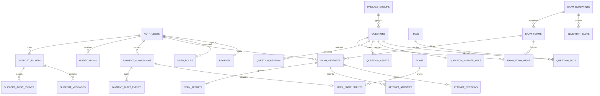

# Logical data model

`AUTH_USERS` is managed by Supabase Auth. Question revisions and answer keys are server-controlled. Attempt writes, transitions, deadlines, grading, payment verification, entitlement changes, support status changes, and notifications use protected database operations. PostgreSQL is the operational source of truth; exports are reporting-only.
