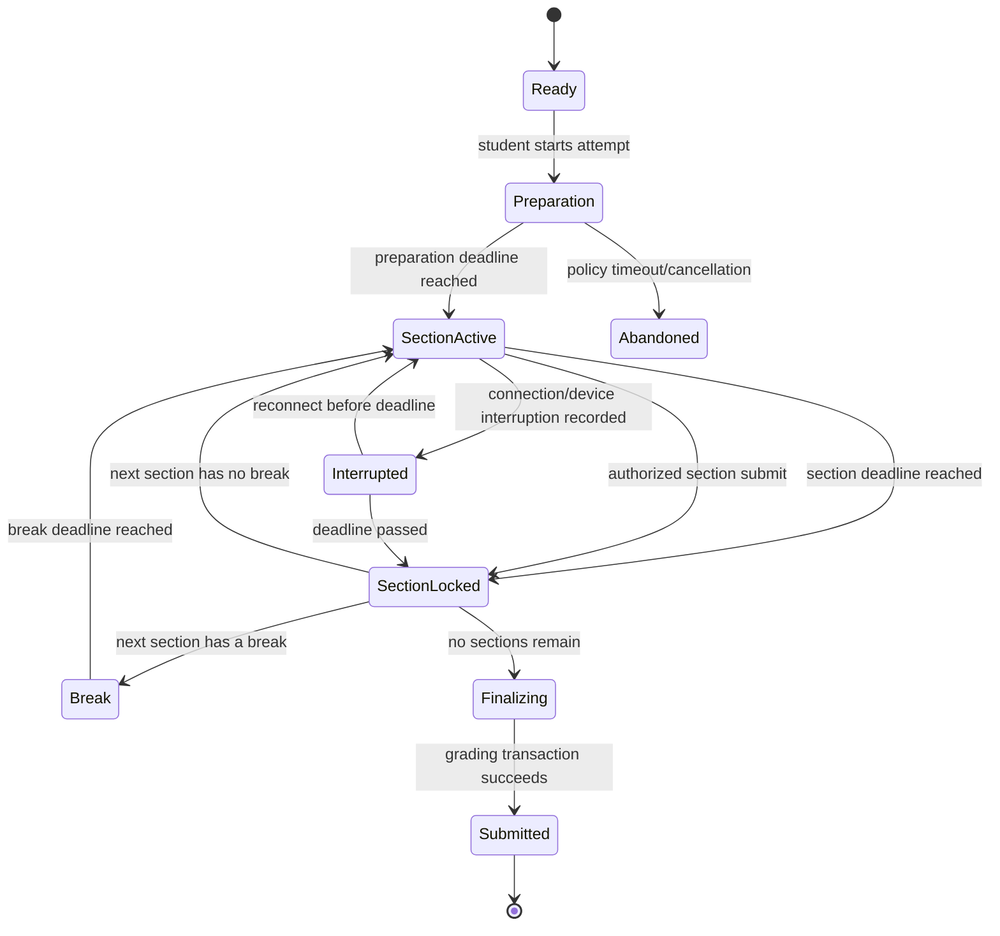

# JLPT Platform — Complete Product, Admin & Deployment Blueprint

**Version:** 8.4 (V7.2 foundation, with V8.0–V8.4 addenda)  
**Updated:** 25 November 2026  
**Supersedes:** V6 build specification where this document adds detail or makes a more specific decision  
**Product:** Independent JLPT N1–N5 mock-exam and preparation platform  
**Implementation stack:** Next.js App Router + TypeScript + Supabase PostgreSQL/Auth/Storage

> V7 expands the platform beyond the public site and sign-in flow. It defines the complete student portal, separate admin experience, bKash manual-payment workflow, spreadsheet reporting, operational settings, security controls, QA and deployment gates. Do not treat a page as complete until its actions, permissions, empty/loading/error states and tests are defined.

---

## Confirmed implementation decisions (22 November 2026)

| Area | Confirmed decision | Implementation consequence |
|---|---|---|
| bKash payment | **Send Money** | Show Send Money instructions and verified recipient details; do not present it as Merchant Payment. |
| Spreadsheet tracking | **Both CSV/XLSX export and Google Sheets sync** | Build database-backed exports plus a server-side, retry-safe Sheets integration. |
| Receipt upload | **Optional** | Permit private optional receipt upload; the image alone never verifies payment. |
| Login OTP | **Risk-based** | Step-up verification for suspicious/high-risk sign-ins; retain expiry, replay protection and rate limits. Admin MFA remains mandatory. |
| Premium duration | **Fixed-duration plans** | Use predefined durations; exact plan lengths, prices and entitlements remain to be selected. |
| Student language | **English and Bangla** | Build bilingual student UI/localization from the start, including core account, payment and exam flows. |

These decisions supersede conflicting open questions below. Details marked as still open must be confirmed before the relevant implementation begins.

---

# JLPT Platform — V7.2 Decision Register and Build Defaults

**Status:** Proposed defaults applied; owner-only details remain pending  
**Purpose:** Keep implementation moving without pretending unconfirmed business, payment, legal or staffing details are known.

## A. Confirmed decisions carried forward

| Area | Decision |
|---|---|
| Payment method | bKash Send Money |
| Payment tracking | CSV/XLSX exports and Google Sheets synchronization |
| Receipt | Optional upload |
| Student login OTP | Risk-based step-up verification |
| Admin authentication | Stronger MFA required |
| Premium duration | Fixed-duration plans |
| Student interface | English and Bangla |
| Payment approval | Human admin verification before entitlement activation |
| Data authority | PostgreSQL is the source of truth; spreadsheets are reporting copies |

## B. Proposed defaults for implementation

These are planning defaults, not facts about the business. They may be changed before launch through configuration or an explicit product decision.

### B1. Product identity

- Working product name: **JLPT Sakura** (temporary internal name only).
- Domain: **PENDING OWNER INPUT**. Do not purchase, configure production email or publish legal documents under this working name until confirmed.
- Brand direction: premium origami/washi learning platform; Sakura tree video is for the homepage hero. Keep exam pages quiet, readable and low-distraction.
- The platform is independent and must not imply official JLPT affiliation or endorsement.

### B2. Free and premium access matrix

| Feature | Free | Premium |
|---|---|---|
| Account, profile and preferences | Included | Included |
| Level guides N1–N5 | Included | Included |
| Sample/diagnostic practice | Limited, available across N1–N5 | Included |
| Full mock exams | One introductory/sample full mock per level, subject to the initial content inventory | All published full mocks |
| Additional practice | Small curated practice allowance | Full practice library |
| Results | Basic raw result and section summary | Detailed raw breakdown and history |
| Answer explanations | Explanations for free sample content | Full explanations for premium content |
| Mistake notebook and bookmarks | Basic bookmarks; mistake history limited to recent attempts | Full mistake notebook and history |
| Progress dashboard | Basic | Detailed trends and filters |
| Targeted practice | Limited curated sets | Full curated sets |
| Ads | No ads in initial product scope | No ads |

Implementation notes:
- This is the recommended launch matrix. The owner may adjust the free allowance before pricing is finalized.
- Do not promise features that are not implemented and content-backed.
- No official JLPT scaled score or pass-probability claim.
- Entitlements must be represented as feature flags/plan permissions in the database, not scattered hardcoded UI conditions.

### B3. Fixed-duration plan structure

Recommended initial catalog:

| Plan code | Display name | Duration | Price |
|---|---|---:|---:|
| `premium_30d` | Premium Monthly | 30 days | **PENDING OWNER INPUT (BDT)** |
| `premium_90d` | Premium Quarterly | 90 days | **PENDING OWNER INPUT (BDT)** |
| `premium_365d` | Premium Annual | 365 days | **PENDING OWNER INPUT (BDT)** |

- Prices are intentionally not invented.
- Store prices as integer minor units (poisha) or exact decimal, never floating point.
- Each payment request stores an immutable snapshot of plan name, duration, price and included entitlements at purchase time.
- Admin can deactivate a plan for new purchases without deleting historical records.

### B4. Existing access and multiple pending payments

Recommended behavior:
- If the user has active premium access, a newly approved fixed-duration purchase **extends from the current expiry timestamp**.
- If the user has no active entitlement or the previous entitlement has expired, a newly approved purchase starts at the approval/activation timestamp.
- Calculate all expiry timestamps on the server in UTC; display in the user's selected timezone.
- Allow **one active pending payment request per user at a time** across plans. The student must cancel or resolve the existing request before submitting another.
- A repeated submission with the same idempotency key returns the existing request.
- A duplicate bKash transaction ID is blocked/flagged and cannot create a second entitlement.
- An admin cannot approve a request that has already been approved, rejected or cancelled.
- Any exceptional manual extension/reversal requires elevated permission, a reason and an audit event.

### B5. bKash Send Money workflow

Confirmed payment method: **Send Money**.

Student form:
- Plan and server-calculated expected amount.
- Sender name.
- Sender bKash number.
- Transaction ID (TrxID).
- Payment date and optional time.
- Reference number only if the actual Send Money flow uses one.
- Optional short note.
- Optional receipt image.
- Terms/accuracy confirmation.

Never request bKash PIN, OTP, password or wallet credentials.

Before launch, owner must provide:
- Exact recipient account display name.
- Exact recipient number.
- Confirmation that the recipient account is suitable for the intended Send Money collection workflow.
- Exact current Send Money instructions and any reference-number behavior.

Do not display a placeholder recipient number on production. Do not call Send Money Merchant Payment.

### B6. Payment review target

Proposed operational target: **within 24 hours**, including weekends only if staff coverage is genuinely available.

- This is an internal target, not a public promise until the owner confirms staffing.
- Show “Usually reviewed within 24 hours” only after the service can meet it consistently.
- Otherwise show neutral wording: “Pending verification — we will notify you after review.”
- Track pending age and alert admins when requests exceed the internal target.

### B7. Refund and cancellation policy — draft for legal/owner review

Recommended operational starting policy (NOT approved legal text):
- Before a payment is made: student may cancel the payment request.
- Pending request: student may request cancellation; admin must verify that no payment has been received before closing it.
- Verified duplicate payment or payment taken in error: investigate and arrange an appropriate refund/adjustment through the payment account workflow.
- Failed, unverified or mismatched transaction: do not activate premium; allow the student to contact support or submit a corrected new request.
- After premium access has been activated: do not promise automatic refunds. Route requests to a documented case review, considering service availability, duplicate/incorrect charges and applicable consumer/payment rules.
- If a refund is approved, record amount, reason, reviewer and transaction evidence. Adjust/revoke entitlement according to the approved refund decision; never silently delete payment history.
- Partial refund and chargeback/dispute handling require an explicit policy.
- Publish no refund promise until reviewed against applicable Bangladesh law and the actual bKash account terms.

### B8. Optional receipt retention and access

Proposed default:
- Retain optional receipt uploads for **90 days after payment resolution**, then delete the file unless a documented accounting, dispute, legal hold or security reason requires longer retention.
- Keep the payment ledger and audit metadata separately according to the approved financial-record retention policy; deleting a receipt does not delete the payment record.
- Private storage only; no public bucket.
- Access limited to `payment_reviewer`, `admin` and `super_admin` when needed for the payment case.
- Support agents see payment status but not receipt images or full sender numbers unless separately authorized.
- Use short-lived signed URLs, log access where feasible, validate file type/size and scan uploads.
- Confirm retention with the owner's accountant/legal adviser before production.

### B9. Content quantity and rights

Recommended initial launch target: **3 reviewed full mock exams per level** (N1, N2, N3, N4 and N5), for 15 total full mocks.

- Treat this as a minimum launch target, not a reason to rush weak content.
- Every paper must pass level/format review, answer-key verification, explanation review, audio QA (where applicable), and final publication approval.
- Questions must be original or explicitly licensed for this use.
- Do not copy official JLPT past questions, proprietary prep-book questions, passages, illustrations or audio without permission.
- Keep provenance and license records for every third-party asset.
- Keep question revisions immutable once used in a published exam form.
- If three high-quality mocks per level are not ready, delay launch or clearly stage access; do not publish unreviewed content.

### B10. Language policy

Confirmed: student interface in English and Bangla.

Recommended default:
- Default UI language: **English**.
- Student can switch to Bangla in preferences; remember the choice.
- Translate all core student-facing flows before launch: registration, navigation, dashboard, payment, subscription, notifications, support, exam instructions and settings.
- Recommended content policy: explanations and study guidance available in both English and Bangla for all published launch content.
- Keep Japanese question text, answer choices, audio and source material unchanged where they are the learning target; translate instructions and explanations without altering the tested meaning.
- Do not machine-translate and publish without human language review.
- Admin interface may launch in English first unless owner requires bilingual admin operations.

### B11. Risk-based login OTP triggers

Require step-up OTP when one or more configured risk signals occur:
- First sign-in from a new/unrecognized device or browser.
- New device combined with unusual network/location signals.
- Repeated failed sign-in attempts or suspected credential stuffing.
- Risk engine flags an abnormal sign-in velocity or impossible-travel pattern.
- Session recovery, sensitive account change or suspicious session behavior.
- Admin sign-in: mandatory MFA regardless of risk score.

Controls:
- OTP has short expiry, one-time use, attempt limits, resend cooldown and replay protection.
- Do not use IP address alone as proof of identity or the sole trigger for account blocking.
- Provide secure recovery and support escalation.
- Log risk decision reason codes, not secrets or OTP values.
- Exact thresholds should be tuned using staging and production telemetry.

### B12. Staff roles and separation of duties

Create named individual staff accounts; do not use shared credentials.

| Role | Allowed scope | Owner input |
|---|---|---|
| `super_admin` | Ownership-level security, staff and critical settings | Name/email pending |
| `admin` | User, plan and platform operations within assigned permissions | Name/email pending |
| `payment_reviewer` | Review payment records, receipts and approve/reject | Name/email pending |
| `support_agent` | Student support and limited account context | Name/email pending |
| `content_editor` | Create/edit draft questions and assets | Name/email pending |
| `content_reviewer` | Review and approve content revisions | Name/email pending |
| `exam_manager` | Blueprints, exam forms and publication | Name/email pending |

- A person may hold more than one role only when operationally necessary and approved.
- Payment submitter must not approve their own payment.
- Content author should not be the sole reviewer of their own high-stakes exam content.
- Require MFA for all staff; stronger MFA for admins and super admins.
- Keep an emergency owner account secured offline with recovery procedures; do not use it for routine work.

### B13. Privacy, terms, support and incident ownership

Owner-only inputs:
- Legal product/operator name and business/contact address if required.
- Public support email and escalation channel.
- Privacy policy owner/approver.
- Terms and refund policy approver.
- Named security incident lead and backup.
- Named emergency access custodian and secure recovery process.

Implementation defaults:
- Collect only information needed to operate accounts, exams, payments and support.
- Publish separate Privacy, Terms, Refund/Cancellation and Contact pages.
- Explain what payment data is collected, who can see it, retention and deletion.
- Provide data export and account deletion request workflows, with lawful retention exceptions clearly explained.
- Incident lead maintains a contact tree and runbooks for compromised admin accounts, payment fraud, data exposure, leaked secrets and outages.
- Do not publish placeholder legal copy as final policy.

## C. Owner confirmation register — remaining inputs

| ID | Owner must supply/approve | Blocks |
|---|---|---|
| O-01 | Final product name and domain | Public launch, email/domain setup |
| O-02 | bKash recipient display name and number | Live payment instructions |
| O-03 | Confirm reference-number behavior for this Send Money flow | Final payment form validation |
| O-04 | BDT prices for 30/90/365-day plans and final feature matrix | Public pricing and payment activation |
| O-05 | Confirm 24-hour review target is staffable | Public payment SLA wording |
| O-06 | Approve refund/cancellation policy after local legal/accounting review | Public legal page and refund operations |
| O-07 | Approve 90-day receipt retention or provide alternate period | Production receipt storage lifecycle |
| O-08 | Confirm 3 full mocks per level and bilingual explanation commitment | Content schedule and launch readiness |
| O-09 | Supply staff names/emails and role assignments | Production admin invitations |
| O-10 | Approve OTP risk triggers and recovery contact | Authentication policy |
| O-11 | Supply support contact and incident lead/backup | Production support and incident response |
| O-12 | Approve Privacy/Terms/Refund text and operator identity | Public launch |

**Build policy:** engineering may proceed using the proposed defaults and configuration placeholders. Production payments, public legal claims, staff invitations and final public launch remain blocked until their corresponding owner inputs are confirmed.

---

# 1. Product outcome and architecture

The finished product has three connected areas:

1. **Public website** — explains the platform and converts visitors into registered learners.
2. **Student workspace** — gives each learner a secure place to prepare, take exams, review results, manage payment and account settings.
3. **Admin workspace** — lets authorized staff operate users, content, exams, payments, entitlements, support and platform settings.

A fourth concern applies to all three: **platform operations** — security, monitoring, backups, incident response and deployment.

## Non-negotiable product rules

- All five JLPT levels (N1–N5) are available at public launch.
- Questions, mock papers, answer keys, explanations and recommendations are manually prepared and reviewed.
- No student-facing AI, live LLM calls or per-student AI API cost.
- The product is independent and must not imply official JLPT endorsement.
- Published questions and exam forms are versioned and immutable.
- Exam timing, submission, grading and premium access are server-authoritative.
- Payment approval is performed by an authorized human after checking the actual bKash transaction record.
- PostgreSQL is the source of truth. CSV/XLSX/Google Sheets are reporting and operational convenience layers, never the authority for account privileges.
- Every privileged admin action is permission-checked and audited.
- Origami/washi visual identity is consistent across the site; exam-taking remains distraction-free and highly readable.

---

# 2. Complete route map

Suggested route structure. Exact paths can change, but page responsibilities and access boundaries should remain.

## 2.1 Public routes

| Route | Page | Main actions |
|---|---|---|
| `/` | Home | Explore levels, see features, register, sign in |
| `/levels` | All levels | Choose N1–N5 |
| `/levels/[level]` | Level overview | View format, mock availability and access |
| `/mock-exams/[examId]` | Mock details | Review duration, requirements and start/upgrade |
| `/pricing` | Plans | Compare free/premium and choose plan |
| `/how-it-works` | How it works | Understand practice workflow |
| `/about` | About | Platform purpose and independent status |
| `/faq` | FAQ | Resolve common questions |
| `/contact` | Contact/support | Submit a support request |
| `/legal/terms` | Terms | Terms of use |
| `/legal/privacy` | Privacy | Data handling and retention |
| `/legal/refunds` | Refund policy | Payment/refund rules |
| `/auth/sign-up` | Registration | Create account |
| `/auth/sign-in` | Student sign-in | Email/password or supported sign-in method |
| `/auth/verify-email` | Verify email | Confirm email |
| `/auth/verify-otp` | OTP verification | Verify login challenge |
| `/auth/forgot-password` | Recovery request | Request recovery |
| `/auth/reset-password` | Reset password | Set new password |

## 2.2 Student routes (authentication required)

| Route | Page | Main actions |
|---|---|---|
| `/app` | Dashboard | See overview and next recommended action |
| `/app/exams` | Exam library | Filter exams by level, availability and status |
| `/app/exams/[examId]` | Exam details | Read instructions and start attempt |
| `/app/attempts/[attemptId]` | Active exam | Answer, navigate, save and submit |
| `/app/results` | Results history | Filter and open past results |
| `/app/results/[resultId]` | Result detail | View raw result and section/category breakdown |
| `/app/review/[attemptId]` | Answer review | Review answers and explanations |
| `/app/mistakes` | Mistake notebook | Revisit incorrect/bookmarked questions |
| `/app/practice` | Targeted practice | Start tag-based practice sets |
| `/app/progress` | Progress | View attempts and reliable trend summaries |
| `/app/bookmarks` | Saved questions | Manage saved questions |
| `/app/subscription` | Plan and access | View free/premium status, plan and expiry |
| `/app/payments` | Payment history | View submitted payment requests and status |
| `/app/upgrade` | Choose premium | Choose available plan |
| `/app/upgrade/bkash` | bKash payment form | Follow instructions and submit payment details |
| `/app/notifications` | Notifications | Read account, payment and exam notices |
| `/app/support` | Support center | Create/view support tickets |
| `/app/settings/profile` | Profile settings | Edit permitted profile fields |
| `/app/settings/security` | Security settings | Password, sessions, OTP/security options |
| `/app/settings/preferences` | Preferences | Language, target JLPT level, display preferences |
| `/app/settings/notifications` | Notification settings | Manage email/product notices |
| `/app/settings/privacy` | Privacy controls | Data export/account deletion request |
| `/app/settings` | Settings overview | Navigate settings |

## 2.3 Admin routes (admin authentication + role authorization)

Admin login is a separate entry page, but **not a separate weaker authentication system**. It uses the same identity provider and stronger role checks.

| Route | Page | Main actions |
|---|---|---|
| `/admin/sign-in` | Admin sign-in | Authenticate and verify admin role |
| `/admin` | Admin dashboard | View operational summary and pending tasks |
| `/admin/payments` | Payment queue | Filter pending/approved/rejected requests |
| `/admin/payments/[paymentId]` | Payment detail | Reconcile, approve or reject |
| `/admin/users` | User directory | Search and filter users |
| `/admin/users/[userId]` | User detail | View account, attempts, payments and access |
| `/admin/entitlements` | Premium access | Inspect/grant/revoke access with audit reason |
| `/admin/plans` | Plans and pricing | Configure plan catalog and availability |
| `/admin/content` | Content dashboard | View question and content inventory |
| `/admin/questions` | Question bank | Create/edit draft revisions |
| `/admin/questions/[questionId]` | Question editor | Edit draft, preview and submit for review |
| `/admin/reviews` | Review queue | Approve/reject content |
| `/admin/assets` | Asset library | Manage listening audio/images |
| `/admin/blueprints` | Exam blueprints | Configure versioned exam structure |
| `/admin/exam-forms` | Exam forms | Assemble, validate and freeze papers |
| `/admin/exam-forms/[formId]` | Exam form detail | Inspect manifest and publish/unpublish where safe |
| `/admin/attempts` | Attempt monitoring | Inspect operational states, not alter student answers |
| `/admin/support` | Support queue | Respond and track cases |
| `/admin/announcements` | Announcements | Publish service notices |
| `/admin/reports` | Reports | View and export operational reports |
| `/admin/audit` | Audit log | Search privileged activity |
| `/admin/staff` | Staff and roles | Invite staff and assign limited roles |
| `/admin/settings/general` | General settings | Site identity and safe global configuration |
| `/admin/settings/payments` | Payment settings | bKash instructions, account details and plan mapping |
| `/admin/settings/security` | Security settings | Auth, session and security policy visibility |
| `/admin/settings/email` | Email settings | Templates and delivery configuration |
| `/admin/settings/notifications` | Notification settings | Configure operational/student notices |
| `/admin/settings/maintenance` | Maintenance | Maintenance banner and controlled maintenance mode |
| `/admin/settings/integrations` | Integrations | Spreadsheet export/sync and storage integration |
| `/admin/settings` | Settings overview | Navigate settings |

---

# 3. Student portal — page-by-page requirements

## 3.1 Student dashboard

Purpose: immediately show the learner what to do next.

Display:
- Greeting and target JLPT level.
- Current access tier and expiry if premium.
- Continue active attempt if one exists.
- Available mock exams for the selected level.
- Recent attempts and latest result.
- Number of unanswered/reviewable mistakes.
- Saved questions.
- A small progress summary based on actual attempts.
- Announcements and payment status when relevant.

Actions:
- Continue exam (only if attempt is valid and in progress).
- Start a mock.
- Review latest result.
- Open mistake notebook.
- Change target level.
- Upgrade or view payment status.

States:
- First-time user with no attempts.
- Free user with locked premium content.
- Premium user.
- Pending payment verification.
- Expired premium.
- User with an active attempt.
- Empty/error/loading states.

Do not invent progress for a learner with no attempt history.

## 3.2 Exam library and level pages

Filters:
- N1–N5.
- Full mock / practice set.
- Available / premium / completed.
- Newest or recommended.

Each exam card shows:
- Exam title and level.
- Timed sections and total planned duration.
- Access requirement.
- Attempt availability/limit if configured.
- Completion status.
- Start, continue, or review action.

Never show a Start action if the user is not entitled or the exam is unpublished.

## 3.3 Active exam

- Server-created attempt bound to a frozen form.
- Section-specific server deadline.
- Autosave with visible saved/saving/offline state.
- Question navigator with answered/unanswered/flagged status.
- Keyboard and touch-friendly options.
- Listening player with correct playback behavior.
- Refresh/resume support.
- Confirmation before final submission.
- Server rejects late answers and duplicate submissions safely.
- No correct answer, explanation or hidden scoring key is sent to the browser before completion.

## 3.4 Results and review

Result detail should include:
- Exam and level.
- Submission date/time.
- Raw correct/incorrect/unanswered counts.
- Raw percentage if clearly labeled as platform raw performance.
- Timed section breakdown.
- Score category breakdown only where mappings are valid.
- Completion/time information.
- Review answers button.
- Practice suggestions based on stored tags.

Use wording such as “Mock exam raw result” rather than “official JLPT score”. Never imply a platform raw percentage is the official scaled score.

## 3.5 Mistake notebook and practice

- List incorrect questions from completed attempts.
- Allow bookmarks independently from mistakes.
- Filter by level, tag, question type and date.
- Open the original explanation and the learner's selected answer.
- Allow “mark reviewed” and “practice similar skill”.
- Avoid repeating the exact question immediately when alternatives exist.
- Do not generate explanations dynamically; use approved prewritten content.

## 3.6 Subscription and upgrade

Show:
- Current plan.
- Current entitlement status.
- Start and expiry dates.
- What the plan unlocks.
- Available upgrade plans.
- Payment history and pending request.
- Support/refund link.

Statuses:
`free`, `pending_payment`, `premium_active`, `premium_expired`, `suspended`, `refunded` (where applicable).

Do not confuse a submitted payment with an active subscription.

## 3.7 Notifications

Notification types:
- Email verification/security notice.
- Payment submitted.
- Payment approved/rejected.
- Premium activated/expiring/expired.
- Exam published or updated.
- Attempt submitted/result ready.
- Support ticket reply.
- Service/maintenance announcement.

Keep an in-app notification record. Email delivery can fail; the in-app record remains the source for the user's notification history.

## 3.8 Support

Student can:
- Open a ticket with category, subject and description.
- Attach permitted proof/screenshots without sensitive credentials.
- View ticket status and staff replies.
- Reopen or reply while allowed.

Ticket statuses:
`open`, `in_progress`, `waiting_for_student`, `resolved`, `closed`.

Do not ask students to send wallet PINs, OTPs, passwords or full card credentials.

---

# 4. bKash manual payment experience

## 4.1 Intended user journey

1. Student signs in and opens **Upgrade**.
2. Student chooses a plan.
3. Payment page displays the exact amount, currency, recipient bKash number/account type and step-by-step payment instructions.
4. Student completes the payment in the bKash app using the stated method.
5. Student returns to the website and submits a payment form.
6. Website validates the form and creates a `pending` payment record.
7. Student sees a receipt/reference number and pending status.
8. Admin opens the payment queue and independently checks the transaction in the merchant/provider record.
9. Admin selects **Approve payment** or **Reject payment** and records a reason.
10. Approval transactionally activates the plan entitlement.
11. Student receives in-app and email notification.
12. Payment and entitlement appear in history and spreadsheet export.

**Critical:** never automatically grant premium because a form was submitted, a screenshot was uploaded, or a transaction ID merely looks valid.

## 4.2 Payment instruction panel

Admin-configurable values:
- Payment provider: bKash.
- Payment type: **Send Money** (confirmed). Display only verified recipient details and exact Send Money instructions.
- Recipient number or merchant identifier.
- Recipient/account display name.
- Amount and currency (BDT).
- Plan name and duration.
- Required payment reference format, if used.
- Step-by-step instructions.
- Support contact.
- Effective date and active/inactive state.

The page must clearly identify this as **bKash Send Money**, not Merchant Payment. Display the verified recipient name/number and exact steps for that account. Do not describe the recipient as a merchant account unless its actual account type supports that claim.

## 4.3 Student payment form

Required fields (confirm exact requiredness after the chosen bKash payment method is fixed):

| Field | Required | Notes |
|---|---|---|
| Selected plan | Yes | Server validates plan and price |
| Amount paid (BDT) | Yes | Must match current plan price |
| Sender name | Yes | Name shown/used by payer |
| Sender bKash number | Yes | Validate format; store with restricted access |
| Transaction ID (TrxID) | Yes | Normalize whitespace/case; unique constraint where appropriate |
| Reference number | Conditional | Required only if the selected payment method produces/uses one |
| Payment date | Yes | User-entered local date |
| Payment time | Optional/conditional | Helpful for reconciliation |
| Payment method/type | Yes | Must match active instruction |
| Note | Optional | Short note only |
| Payment screenshot/receipt | Optional | Private upload; not sufficient proof by itself |
| Terms confirmation | Yes | Confirm details are accurate |

Do not collect:
- bKash PIN.
- OTP.
- Password.
- Card number/CVV.
- Any account login credential.

Use Zod validation on the server as well as client-side form validation. Client validation is only for user experience.

## 4.4 Submission confirmation

After successful submit, show:
- Payment request number.
- Plan and submitted amount.
- Transaction ID partially masked.
- Submission date/time.
- Status: **Pending verification**.
- Expected review time (only if an actual service target is defined).
- “View payment status” action.

Prevent accidental duplicate submission:
- Disable the submit button while request is in flight.
- Use an idempotency key.
- Enforce unique provider transaction reference where appropriate.
- If a duplicate is detected, show the existing request status rather than creating a second entitlement.

## 4.5 Payment status lifecycle

`draft → pending → under_review → approved`  
Alternative terminal paths: `rejected`, `cancelled`, `refunded`.

Student-facing status labels:
- Pending: received; awaiting review.
- Under review: an admin is checking the transaction.
- Approved: payment verified; access activated.
- Rejected: not verified; show a safe reason and support route.
- Refunded: refund recorded; entitlement adjusted according to policy.
- Cancelled: request withdrawn/invalidated.

Status transitions must be enforced on the server and audited.

## 4.6 Admin payment queue

Dashboard cards:
- Pending count.
- Under-review count.
- Approved today.
- Rejected today.
- Total collected in selected period (only from verified records).

Queue columns:
- Request ID.
- Student name/email.
- Plan.
- Amount.
- Sender number (masked by default).
- Transaction ID.
- Submitted time.
- Age of request.
- Status.
- Assigned reviewer.

Filters:
- Status.
- Date range.
- Plan.
- Transaction ID.
- Request ID.
- User email/user ID.
- Reviewer.

## 4.7 Admin payment detail and approval controls

Detail view displays:
- Payment request ID.
- Student identity and account status.
- Selected plan and expected price.
- Submitted amount.
- Sender name and bKash number.
- Transaction ID and reference number.
- Payment date/time.
- Private receipt attachment if supplied.
- Previous requests from this student.
- Possible duplicate transaction warning.
- Current subscription/entitlement.
- Audit history.

Admin verification checklist:
1. Confirm recipient account and payment method.
2. Find the transaction in the merchant/provider statement or trusted bKash record.
3. Match transaction ID.
4. Match amount and currency.
5. Match date/time within a reasonable reconciliation window.
6. Check recipient account.
7. Check transaction is not already used for another request.
8. Check selected plan and current price.
9. Record verification evidence/reference (not a secret).
10. Approve or reject.

Buttons:
- **Mark as under review**
- **Approve payment**
- **Reject payment**
- **Return to pending** (only if workflow permits and reason is mandatory)
- **Open user account**

Approval button behavior:
- Confirmation dialog shows user, plan, amount and transaction ID.
- Reviewer must have `payment_reviewer` or higher permission.
- Reviewer enters a short internal verification note.
- Server rechecks current status and duplicate transaction constraints.
- One database transaction marks payment approved, creates/extends entitlement, records reviewer and audit event, and creates student notification.
- If any step fails, the entire transaction rolls back.
- A second click/retry returns the existing result; it must not grant duplicate time.
- The reviewer cannot approve a payment they submitted as a student (if staff can also have student accounts).
- Approval is not implemented as a direct browser update to a table.

Rejection behavior:
- Require a reason category and safe student-facing explanation.
- Internal note may contain additional details.
- Do not expose internal fraud/security notes to the student.
- Rejected request cannot be edited into approved; create a new request or use a separately audited reversal workflow.

## 4.8 Entitlement activation rules

Define exact policy before implementation:
- Fixed plan durations (confirmed); exact duration options and start-time rule still need approval.
- Whether a new purchase extends an existing active subscription from its expiry or starts immediately.
- Whether multiple pending requests are allowed.
- Whether refunds revoke access immediately or at period end.
- Whether staff can grant complimentary access and who can authorize it.

Store:
- User.
- Plan.
- Source payment.
- Status.
- Starts at.
- Expires at.
- Granted by/system event.
- Revoked at/by/reason.
- Created and updated timestamps.

Every premium feature must check entitlement on the server. Hiding a button in the UI is not access control.

---

# 5. Spreadsheet and payment reporting

## 5.1 Recommended design

**Database first; spreadsheet second.**

PostgreSQL is the authoritative payment ledger. The admin portal should offer:
- Download CSV.
- Download XLSX.
- Optional controlled Google Sheets sync if the owner explicitly chooses it.

Do not make an Excel file on one admin's computer the live entitlement database.

## 5.2 Suggested spreadsheet columns

| Column | Purpose |
|---|---|
| Payment Request ID | Stable unique key |
| Submitted At (UTC) | Audit timestamp |
| Submitted At (Bangladesh time) | Admin convenience |
| Student ID | Internal user UUID or safe identifier |
| Student Name | Reconciliation |
| Student Email | Contact |
| Plan Code | Plan |
| Plan Name | Human-readable plan |
| Expected Amount | Expected BDT |
| Submitted Amount | User-entered BDT |
| Payment Method | bKash method |
| Sender Name | Payer |
| Sender Number (masked) | Privacy-conscious reconciliation |
| Transaction ID | Reconciliation |
| Reference Number | If applicable |
| Payment Date/Time | User-entered transaction time |
| Status | Pending/under review/approved/rejected/refunded |
| Reviewer | Staff identity |
| Reviewed At | Audit timestamp |
| Rejection Reason | Safe reason code |
| Entitlement Start | Granted access |
| Entitlement Expiry | Granted access |
| Spreadsheet Sync Status | If external sync enabled |

Only authorized admins can export unmasked sender numbers or other sensitive fields. Default exports should mask personal numbers where possible.

## 5.3 Export/sync behavior

- Export is generated from database records using server-side authorization.
- Record who exported, when and which date range.
- Use a stable Payment Request ID so external rows can be updated without duplicates.
- If Google Sheets sync is enabled, use a server-side service account with minimum permissions; never put its key in browser code.
- Store `last_synced_at`, `sync_status`, and `sync_error` on an integration log, not on the payment's approval state.
- Sync failure must not block payment approval or entitlement activation.
- Reconciliation jobs must be retry-safe.
- Do not allow spreadsheet edits to change payment status or premium entitlements.

---

# 6. Admin workspace — responsibilities and permissions

## 6.1 Roles

Use explicit roles and granular permissions. Suggested initial roles:

| Role | Capabilities |
|---|---|
| `student` | Own profile, exams, results, own payments |
| `support_agent` | View limited user/support context; respond to tickets |
| `content_editor` | Create/edit draft questions and assets |
| `content_reviewer` | Review/approve/reject content |
| `exam_manager` | Manage blueprints, forms and publication |
| `payment_reviewer` | Review payment submissions and approve/reject |
| `admin` | Manage users, plans, staff and operational settings |
| `super_admin` | Critical security/ownership actions |

Avoid giving every staff member `admin`. Staff accounts should use MFA and individual identities. No shared admin password.

## 6.2 Admin dashboard

Widgets:
- Pending payment requests.
- New registrations.
- Active premium users.
- Premium expiring soon.
- Published exams by level.
- Questions awaiting review.
- Open support tickets.
- Recent audit events.
- System health/last backup indicators where available.

Quick actions:
- Review next payment.
- Add question.
- Review content.
- Create exam form.
- Respond to support.

Only show data the admin role is allowed to see.

## 6.3 User management

Search/filter:
- Email, name, user ID.
- Registration date.
- Email verified status.
- Account state.
- Target JLPT level.
- Free/premium status.
- Payment status.

User detail:
- Profile and verification state.
- Registration and last activity metadata.
- Attempts and results summary.
- Payment request history.
- Current entitlement.
- Support tickets.
- Admin audit history affecting the account.

Actions:
- Suspend/reactivate with reason and expiry where applicable.
- Trigger account recovery email.
- Correct safe profile fields.
- Grant/revoke complimentary access only with permission, reason and audit.
- Never display password, OTP or secret authentication material.
- Avoid permanent deletion as a routine admin button; use controlled privacy/deletion workflow.

## 6.4 Plans and pricing

Admin can configure:
- Plan code/name.
- Amount/currency.
- Duration.
- Feature entitlements.
- Active/inactive state.
- Display order and copy.

Rules:
- Store price snapshots on payment requests; changing a plan later must not change an existing request.
- A plan with pending payments cannot be silently deleted.
- Price changes are versioned/audited.
- All premium feature checks use entitlement rules, not hardcoded UI conditions.

## 6.5 Content administration

- Question bank with draft/review/approved/retired states.
- Revision history.
- Tags and level.
- Passage/dialogue groups.
- Audio/image assets.
- Review notes and reviewer identity.
- Duplicate detection and preview.
- Blueprint quotas.
- Frozen exam form manifest.
- Publish validation.

No unreviewed question can enter a published paper.

## 6.6 Exam operations

Admin may:
- Inspect attempt states and error reports.
- See aggregate completion/abandonment.
- Review reported exam issues.
- Cancel an exam form only under a documented policy.
- Publish corrected future versions.

Admin should not casually edit a student's submitted answers, deadlines or results. Corrections require a reason, a separate audited correction record and a policy for student notification.

## 6.7 Support management

- Ticket queue and SLA labels.
- Assign staff.
- Internal notes separated from student-visible replies.
- Categories: payment, account, exam issue, content issue, technical issue, other.
- Attachments with private access.
- Close/reopen controls.
- Audit of staff actions.

## 6.8 Reports

Useful reports:
- Registrations by day/week/month.
- Verified payments and amount collected.
- Pending payment ageing.
- Premium active/expired counts.
- Mock attempts by level.
- Completion and abandonment rates.
- Question performance and item quality indicators.
- Support volume and resolution time.

Use aggregate data by default. Restrict personal information to staff who need it.

---

# 7. Settings pages

## 7.1 Student settings

**Profile**
- Display name.
- Preferred explanation language (only enabled languages).
- Target JLPT level.
- Optional timezone preference.
- Profile update confirmation.

**Security**
- Change password.
- View active sessions where supported.
- Sign out other sessions.
- Configure/recover supported second factor.
- Recent security notices.
- Email change verification.

**Preferences**
- Language.
- Time display.
- Reduced motion.
- Theme preference if light/dark themes are supported.
- Default exam level.

**Notifications**
- Essential security/payment notices cannot be disabled where legally/operationally required.
- Optional learning/news email preferences.
- In-app notification controls.

**Privacy**
- Request data export.
- Request account deletion.
- Explain retention exceptions for financial/audit records.
- Confirm high-impact actions.

## 7.2 Admin settings

**General**
- Product name and support email.
- Public site URL.
- Timezone display.
- Maintenance banner.

**Payment**
- Active payment methods.
- bKash recipient details.
- Payment instructions.
- Supported plan mappings.
- Payment review notification recipients.
- Export configuration.

**Email**
- Sender identity.
- Verification/recovery templates.
- Payment received/approved/rejected templates.
- Expiry reminders.
- Test delivery and delivery logs.

**Security**
- Admin MFA requirement.
- Session policy.
- Rate-limit configuration.
- Staff roles and permissions.
- Allowed integration origins.
- Security event review.

**Integrations**
- Spreadsheet sync status.
- Storage status.
- Email provider status.
- Webhook status (if later used).
- Rotate credentials using secure server-side configuration.

**Maintenance**
- Banner text.
- Start/end window.
- Optional read-only maintenance mode.
- Never disable database authorization because maintenance mode is active.

**Audit**
- Filter by actor, action, target and date.
- Export restricted audit report.
- Audit records are append-only for normal admins.

---

# 8. Database design additions and constraints

## 8.1 Core tables

- `profiles`
- `user_roles`
- `role_permissions` (or a fixed permission map in server code plus role assignments)
- `plans`
- `plan_versions` or immutable price snapshots
- `payment_submissions`
- `payment_audit_events`
- `user_entitlements`
- `admin_audit_events`
- `notifications`
- `support_tickets`
- `support_messages`
- `announcements`
- `user_sessions` only if needed beyond Auth provider capabilities
- `integration_configs` (store secret references, not raw client-readable secrets)
- `integration_sync_logs`
- `admin_exports`
- `site_settings` for non-secret settings only

V6 content, exam, attempt and result tables remain required.

## 8.2 Payment record minimum fields

`payment_submissions`:
- `id` UUID primary key.
- `public_reference` unique human-friendly request ID.
- `user_id` foreign key.
- `plan_id` foreign key.
- `plan_version` or immutable plan snapshot.
- `expected_amount_minor` integer (BDT poisha) or exact decimal; do not use floating point.
- `submitted_amount_minor`.
- `currency` (`BDT`).
- `provider` (`bkash`).
- `payment_method_type`.
- `sender_name`.
- `sender_number_encrypted` or protected column/access strategy.
- `transaction_id_normalized`.
- `reference_number` nullable/conditional.
- `paid_at` timestamp.
- `submitted_at` timestamp.
- `status`.
- `reviewer_user_id` nullable.
- `reviewed_at` nullable.
- `review_note_internal` nullable.
- `rejection_reason_code` nullable.
- `idempotency_key`.
- `created_at`, `updated_at`.

Constraints:
- Positive amount.
- Currency constrained.
- Valid status enum.
- Unique idempotency key per user/request context.
- Unique provider + normalized transaction ID where appropriate; handle nulls and provider semantics correctly.
- Foreign keys and indexes for queue filters.
- No client permission to set status, reviewer, entitlement or audit fields.

## 8.3 Entitlement constraints

- Use one consistent entitlement model.
- Every entitlement references its source (payment, admin grant, promotion).
- Store start and expiry as UTC timestamps.
- Enforce valid date range.
- Prevent accidental overlapping duplicate grants where policy requires.
- Every grant/revoke has an audit event.
- Server checks entitlement at the point of use.

## 8.4 Audit events

Capture:
- Actor user ID and role.
- Action.
- Target type and ID.
- Timestamp.
- Request/correlation ID.
- Before/after safe metadata.
- Reason.
- IP/risk metadata only as justified by policy.

Never store passwords, OTPs, wallet PINs, raw secret keys or full payment authentication credentials in audit logs.

---

# 9. Security model

## 9.1 Authentication

- Email verification mandatory.
- Login OTP or supported second-factor flow with expiry, rate limiting and replay protection.
- Admin accounts require stronger MFA.
- Secure recovery process.
- Session revocation for compromised accounts.
- Avoid custom password/OTP cryptography.

## 9.2 Authorization

- Authentication answers “who are you?”; authorization answers “what may you do?”
- Protect every route and every server action/route handler.
- Check roles/permissions on the server for every privileged action.
- Enforce row ownership in PostgreSQL RLS.
- Enable RLS on all exposed tables and grant only required operations.
- Remember: policies do not automatically revoke SQL grants.
- Supabase service-role/secret keys bypass RLS and must remain server-side.
- Do not trust a role value supplied by a browser form or editable profile column.
- Use least-privilege staff roles.

## 9.3 Sensitive data

- Mask sender number in queue by default.
- Restrict full sender number to payment reviewers.
- Private storage for payment receipts.
- Signed, short-lived access URLs for authorized reviewers.
- Retention and deletion policy for receipts and payment identifiers.
- HTTPS everywhere.
- Secure, HttpOnly, SameSite cookies as appropriate to the auth integration.
- CSRF protections where applicable.
- Input validation and output encoding.
- Rate limiting for sign-in, OTP, payment submission, support and admin actions.
- File type, size and malware checks for uploads.
- CSP and security headers.
- No secrets in source control, logs, browser bundles or screenshots.

## 9.4 Abuse and fraud controls

- Duplicate transaction detection.
- Rate limit payment submissions.
- Flag repeated mismatched amount/plan.
- Flag same transaction submitted by multiple users.
- Flag unusual account/payment patterns for human review.
- Do not auto-ban solely based on IP; shared/mobile/VPN IPs are common.
- Maintain a documented appeal/support process.

---

# 10. Email and notification workflows

Templates to prepare:
- Verify email.
- Login OTP.
- Password recovery.
- Payment request received.
- Payment approved and premium activated.
- Payment rejected with safe reason.
- Premium expiry reminder.
- Premium expired.
- Support ticket reply.
- Exam result ready.
- Important maintenance notice.

Requirements:
- Use a trusted SMTP/email provider and verified sender domain.
- Record delivery state and provider message ID where available.
- Retry transient failures safely.
- Do not let email failure roll back payment approval; in-app notification remains.
- Avoid leaking transaction details or sensitive personal information in email subject/body.

---

# 11. Spreadsheet integration details

Start with downloadable CSV/XLSX exports. Add live Google Sheets sync only if the operating workflow genuinely needs it.

If Google Sheets sync is enabled:
- Use a dedicated service account owned by the platform.
- Share only the target sheet with that service account.
- Keep credentials in server-side secret storage.
- Use Payment Request ID as the stable row key.
- Upsert rows; do not append duplicates on every retry.
- Track sync logs separately from payment state.
- Restrict spreadsheet editors.
- Do not let spreadsheet edits update the platform.
- Create a periodic reconciliation report comparing approved database payments to exported rows.

---

# 12. Deployment architecture

## 12.1 Environments

Maintain separate:
- Local development.
- Staging/test.
- Production.

Use separate Supabase projects for staging and production. Never use real payment/user data in local or staging tests.

## 12.2 Recommended hosting layout

- Next.js app on a managed Node.js-compatible host (Vercel is a practical option; other Node.js hosts are possible).
- Supabase production project in a region appropriate for expected users and data requirements.
- Custom domain and HTTPS.
- Transactional email provider with verified sender domain.
- Error monitoring and uptime checks.
- Object storage for private receipts/audio.
- Automated database backups and tested restore procedure.

The app must use server-capable deployment; do not choose static export if server actions, authenticated routes or server-side exam/payment logic are required.

## 12.3 Environment variables

Example categories (names are illustrative; confirm exact library names):
- Public Supabase URL and publishable key.
- Server-only Supabase secret/service role key if absolutely required.
- Site URL and allowed origins.
- Email provider credentials.
- Storage configuration.
- Spreadsheet service account secret if enabled.
- Error monitoring DSN.
- Payment instructions may be database-managed non-secret values.

Rules:
- `.env*` secrets are gitignored.
- Only intentionally public values use `NEXT_PUBLIC_`.
- Never expose service role/secret keys to the browser.
- Separate credentials for staging and production.
- Rotate secrets if exposed.
- Validate required environment variables at startup/build.
- No production secrets in sample `.env.example`.

## 12.4 CI/CD

On each pull request:
1. Install using lockfile.
2. TypeScript check.
3. ESLint.
4. Unit tests.
5. Database migration validation.
6. Build.
7. RLS/policy tests.
8. Relevant Playwright smoke tests.

On merge to staging:
- Apply staging migrations.
- Deploy staging.
- Run smoke tests and payment sandbox/manual test cases.

On production release:
- Backup/checkpoint.
- Review migrations and rollback strategy.
- Deploy application.
- Apply backward-compatible migrations in controlled order.
- Run health checks.
- Verify sign-in, exam, payment submission and admin approval flows.
- Monitor errors and database performance.

Never test real bKash transactions with live users during staging.

## 12.5 Database migration strategy

- All schema changes committed as migration files.
- No manual production schema edits as the normal workflow.
- Backward-compatible expand/migrate/contract changes for risky alterations.
- Seed only safe reference data.
- Production data is never overwritten by development seeds.
- Test restore from backup before launch and periodically thereafter.

---

# 13. Monitoring, backups and incident response

## 13.1 Monitor

- App uptime and HTTP error rates.
- Server exceptions.
- Authentication/OTP failures and rate-limit activity.
- Payment queue age.
- Payment approval failures.
- Duplicate transaction attempts.
- Entitlement activation failures.
- Email delivery failures.
- Database CPU, connections, slow queries and storage.
- Storage upload failures.
- Exam submission/autosave errors.
- Core Web Vitals.

## 13.2 Alerts

Alert an operator for:
- App unavailable.
- Database unavailable or near resource limits.
- Payment approval transaction failures.
- Sudden payment queue backlog.
- Repeated auth abuse.
- Backup failure.
- Spreadsheet sync failure (if enabled).
- Email provider outage.
- Unusual admin privilege changes.

## 13.3 Backup and recovery

- Confirm Supabase backup/PITR capabilities and plan limits.
- Define RPO (maximum acceptable data loss) and RTO (maximum acceptable recovery time).
- Keep database backups and critical asset backups.
- Periodically test restoration into a separate environment.
- Document emergency access and recovery contacts.
- Do not assume a backup is usable until restore has been tested.

## 13.4 Incident runbooks

Write short procedures for:
- Compromised admin account.
- Suspected unauthorized premium grants.
- Payment reconciliation mismatch.
- Database outage.
- Email/OTP delivery outage.
- Accidental content publication.
- Leaked secret key.
- Data exposure or privacy incident.
- Failed deployment and rollback.

---

# 14. Performance, accessibility and UX quality

- Mobile-first responsive layouts.
- Optimize Sakura hero video with poster and reduced-motion fallback.
- Use compressed modern image formats.
- Lazy-load non-critical assets.
- Keep exam screen light and fast.
- Avoid unnecessary client-side JavaScript.
- Cache only public/immutable data appropriately; never accidentally cache private student/admin pages across users.
- Use loading skeletons and meaningful empty/error states.
- Accessible labels, focus states, keyboard navigation and contrast.
- Verify Japanese glyphs, audio and question layout on common browsers.
- Test slow/mobile networks.
- Use clear confirmation for destructive or privileged actions.

---

# 15. QA plan — required end-to-end scenarios

## 15.1 Authentication

- New registration and email verification.
- Unverified user cannot access protected pages.
- Correct OTP accepted.
- Expired OTP rejected.
- Reused OTP rejected.
- Rate limits applied.
- Password recovery.
- Logout and session revocation.
- Student cannot access admin routes.
- Admin without required role denied.

## 15.2 Student learning

- New student sees correct empty dashboard.
- Student selects target level.
- Free user sees premium lock.
- Premium user sees entitled exams.
- Start exam, answer, refresh, resume.
- Section deadline locks answers.
- Submit and grade once.
- Result and explanation appear only after submission.
- Mistake notebook and bookmark behavior.
- Attempt history and progress are accurate.

## 15.3 Payments

- Correct bKash instructions for selected method.
- Valid payment form creates pending record.
- Invalid amount rejected.
- Invalid number rejected.
- Missing required TrxID rejected.
- Duplicate TrxID blocked/flagged.
- Receipt upload is private.
- Student cannot approve own request.
- Student cannot modify payment status.
- Payment reviewer can inspect request.
- Unauthorized staff cannot approve.
- Approval creates exactly one entitlement.
- Double-click/retry does not extend twice.
- Rejection does not grant access.
- Student sees status and notification.
- Export matches database.
- Spreadsheet sync retry does not duplicate rows.

## 15.4 Admin

- Role-specific dashboard data.
- User search and account detail.
- Suspension/reinstatement audit.
- Plan update preserves historical payment price.
- Question draft/review/approval.
- Exam blueprint validation and frozen form.
- Support ticket response.
- Audit search and export permissions.
- Settings changes logged.

## 15.5 Production readiness

- Production build succeeds.
- No missing environment variables.
- RLS tests pass for every exposed table.
- Security Advisor review complete.
- SSL/network restrictions reviewed.
- Admin MFA enabled.
- Backup restore tested.
- Email sender verified.
- Custom domain and HTTPS working.
- Monitoring and alerts active.
- Legal/support pages live.
- Mobile and desktop smoke tests pass.

---

# 16. Delivery roadmap — finish in dependency order

Do not build every page independently before the underlying permission and data model exists. Build vertical slices with working backend behavior.

## Phase 0 — Product decisions (before coding payment/admin)

Use the V7.2 proposed defaults as the implementation baseline. Obtain owner confirmation for:
- Product name/domain.
- Final free/premium matrix and BDT prices for fixed 30/90/365-day plans.
- Verified bKash Send Money recipient name/number and reference-number behavior.
- Whether a 24-hour review target can be met.
- Refund/cancellation policy and receipt retention after local review.
- Staff identities/role assignments, support contact and incident ownership.
- Final bilingual content scope and launch inventory of 3 reviewed full mocks per level.
- Privacy, terms and refund text.

Already confirmed and not to be reopened without a new decision: Send Money, CSV/XLSX + Google Sheets, optional receipt, risk-based student OTP, fixed-duration plans, English + Bangla UI.

**Exit:** schema-affecting decisions are stable; unresolved owner-only values are represented as safe configuration placeholders and production payment activation remains disabled until verified.

## Phase 1 — Foundation and access control

- Create Next.js project and repository.
- Configure Supabase local/staging/prod projects.
- Build design tokens and origami layout components.
- Implement auth, email verification, risk-based login OTP and profiles.
- Require stronger MFA for admin accounts.
- Add English/Bangla localization framework before building student-facing screens.
- Implement role/permission model.
- Add RLS and server authorization.
- Build public and authenticated route guards.
- Create audit infrastructure.

**Exit:** students, staff and admins have correct access boundaries.

## Phase 2 — Student account shell

- Student navigation/sidebar.
- Dashboard.
- Profile settings.
- Security settings.
- Preferences and notifications.
- Subscription page.
- Payment history page.
- Support center.

**Exit:** all post-sign-in account pages load real user-scoped data and have proper empty/error states.

## Phase 3 — Admin shell and operations

- Admin sign-in entry.
- Admin dashboard.
- Role-aware navigation.
- User directory/detail.
- Staff/roles.
- Audit log.
- General settings.

**Exit:** no student can access admin pages; staff see only permitted operations.

## Phase 4 — bKash payment and entitlement vertical slice

- Plan catalog and price snapshots.
- Admin bKash Send Money instruction settings (verified recipient number/name and exact steps).
- Optional private receipt upload and retention policy.
- Student upgrade page.
- Payment form and private receipt upload.
- Pending queue.
- Payment detail/reconciliation checklist.
- Approve/reject controls.
- Atomic entitlement activation.
- Notifications.
- Payment history.
- CSV/XLSX export.
- Google Sheets sync with server-side credentials, stable request-ID upserts, sync logs and retry handling.
- Duplicate/idempotency tests.

**Exit:** one verified payment creates exactly one correct entitlement, and no unverified payment grants access.

## Phase 5 — Content and exam management

- Question bank and revisions.
- Review workflow.
- Asset management.
- Blueprints.
- Exam form assembly and freeze.
- Exam publishing.
- Admin exam monitoring.

**Exit:** staff can prepare and publish a validated exam without manual production database edits.

## Phase 6 — Exam and student learning loop

- Exam library/details.
- Lobby and active attempt.
- Timers, autosave, resume and submission.
- Grading.
- Results and review.
- Mistake notebook.
- Targeted practice and progress.

**Exit:** student can complete the full prepare → test → review → practice cycle.

## Phase 7 — Public website and brand polish

- Homepage and origami Sakura video.
- Level pages.
- Pricing and FAQ.
- About/contact/legal.
- SEO metadata.
- Responsive and motion QA.

**Exit:** public marketing site accurately represents implemented product features.

## Phase 8 — Production hardening and launch

- Security review and RLS test suite.
- Payment reconciliation drill.
- Full end-to-end tests.
- Load/performance test.
- Accessibility test.
- Backup/restore drill.
- Monitoring/alerts.
- Domain/email verification.
- Beta cohort.
- Fix launch blockers.
- Production launch.

**Exit:** launch checklist signed off; no known critical/high security or payment defects.

---

# 17. Launch go/no-go checklist

A launch is **NO-GO** if any critical item fails.

## Product
- [ ] Public pages are complete and truthful.
- [ ] Student portal pages and actions are complete.
- [ ] Admin portal pages and actions are complete.
- [ ] N1–N5 have reviewed published mock content.
- [ ] No dead links or placeholder controls.

## Payment
- [ ] bKash method and recipient account are confirmed.
- [ ] Form fields match the actual transaction flow.
- [ ] Admin can independently verify a payment.
- [ ] Approve/reject actions work and are audited.
- [ ] Approval grants the correct access exactly once.
- [ ] Rejected/pending payments never grant access.
- [ ] Student can see payment history/status.
- [ ] CSV/XLSX export is correct and access-controlled.
- [ ] Refund and duplicate-payment procedures exist.

## Security
- [ ] RLS enabled and tested on exposed tables.
- [ ] Role checks on every admin operation.
- [ ] Service-role/secret keys server-only.
- [ ] Admin MFA enforced.
- [ ] Rate limits and abuse controls active.
- [ ] Sensitive payment data access restricted.
- [ ] Security headers and HTTPS configured.
- [ ] No critical/high vulnerabilities remain.

## Reliability
- [ ] Staging and production separated.
- [ ] CI checks pass.
- [ ] Production build succeeds.
- [ ] Database migration and rollback plan reviewed.
- [ ] Backup restore tested.
- [ ] Monitoring/alerts active.
- [ ] Error pages and support process live.

## Experience
- [ ] Mobile/desktop layouts tested.
- [ ] Exam interface is readable and stable.
- [ ] Origami theme is consistent but not distracting.
- [ ] Hero video has a static fallback.
- [ ] Accessibility checks pass.
- [ ] Japanese text/audio tested.

## Legal and operations
- [ ] Privacy, terms and refund policy published.
- [ ] Copyright-safe content process followed.
- [ ] Support contact and admin ownership established.
- [ ] Incident runbooks and emergency access documented.

---

# 18. Remaining owner decisions and launch blockers

The proposed defaults and implementation behavior are defined in the **V7.2 Decision Register** near the beginning of this document. Do not ask the owner to decide those items again unless they want to change them.

The remaining owner inputs are:
1. Final product name and domain.
2. Verified bKash Send Money recipient display name and number.
3. Confirm whether the selected Send Money process uses a reference number.
4. Final BDT prices and included privileges for the 30-, 90- and 365-day plans.
5. Confirm whether the proposed 24-hour payment review target is operationally achievable.
6. Approve refund/cancellation policy after appropriate local review.
7. Approve receipt retention period (proposed: 90 days after payment resolution).
8. Confirm launch content target (proposed: 3 reviewed full mocks per level) and bilingual explanations/study content.
9. Named staff and role assignments.
10. Final risk-based OTP policy and recovery contact.
11. Public support contact, incident lead and backup.
12. Approved Privacy, Terms and Refund/Cancellation text and operator identity.

See the Owner Confirmation Register in the V7.2 Decision Register for the exact dependency each item blocks.

**Important:** do not put fake bKash recipient details, invented staff identities, unapproved prices or placeholder legal text into production.
---

# 19. Technical references checked for this revision

These are implementation references, not a substitute for project-specific testing:

- Supabase Production Checklist: https://supabase.com/docs/guides/deployment/going-into-prod
- Supabase Production Security Checklist: https://supabase.com/docs/guides/security/production-checklist
- Supabase Row Level Security: https://supabase.com/docs/guides/database/postgres/row-level-security
- Supabase Next.js quickstart: https://supabase.com/docs/guides/getting-started/quickstarts/nextjs
- Next.js Production Checklist: https://nextjs.org/docs/app/guides/production-checklist
- Next.js deployment guide: https://nextjs.org/docs/app/getting-started/deploying
- bKash Merchant information: https://www.bkash.com/en/business/merchant

Current documentation emphasizes RLS and least-privilege grants, server-only handling of secret/service-role keys, verified email/OTP configuration, performance checks, load testing, and a production checklist. Recheck the provider documentation and the actual bKash account workflow before launch.

---

# 20. Decision log

| Date | Decision/update | Effect |
|---|---|---|
| 2026-11-19 | All N1–N5 required at launch; N5 first technical pilot | Preserved |
| 2026-11-22 | Manual content; no runtime LLM dependency | Preserved |
| 2026-11-22 | Origami/washi identity and Sakura hero video | Preserved |
| 2026-11-22 | Database is source of truth; spreadsheet is export/reporting | Reaffirmed |
| 2026-11-22 | Expanded full student portal after sign-in | Added |
| 2026-11-22 | Separate admin sign-in entry with same identity provider and strict role checks | Added |
| 2026-11-22 | bKash payment form with sender details, transaction ID and conditional reference number | Added |
| 2026-11-22 | Admin approval/rejection with atomic entitlement activation and audit | Added |
| 2026-11-22 | Student/admin settings, notifications, support, reporting and operations | Added |
| 2026-11-22 | Staging, CI/CD, monitoring, backup/restore and launch gates | Added |
| 2026-11-22 | bKash Send Money selected (not Merchant Payment) | Confirmed |
| 2026-11-22 | CSV/XLSX exports and Google Sheets sync both required | Confirmed |
| 2026-11-22 | Receipt upload optional | Confirmed |
| 2026-11-22 | Risk-based login OTP; admin MFA remains required | Confirmed |
| 2026-11-22 | Fixed-duration premium plans | Confirmed; exact durations/prices open |
| 2026-11-22 | English and Bangla student interface | Confirmed |

| 2026-11-22 | V7.2 proposed free/premium matrix and fixed 30/90/365-day plan structure | Proposed defaults; prices pending |
| 2026-11-22 | Premium purchase extends from active expiry; one pending payment per user | Proposed default |
| 2026-11-22 | 24-hour payment review target | Proposed; owner must confirm staffing |
| 2026-11-22 | Optional receipt retention 90 days after payment resolution | Proposed; legal/accounting review required |
| 2026-11-22 | Three reviewed full mocks per level (15 total) for launch | Proposed content target |
| 2026-11-22 | English default UI with Bangla switch; bilingual explanations recommended | Proposed language policy |
| 2026-11-22 | Risk-based OTP trigger categories documented; admin MFA mandatory | Proposed security policy |
| 2026-11-22 | Staff role separation and owner-only identity register added | Added |
| 2026-11-22 | Refund/cancellation draft and privacy/incident ownership requirements added | Proposed; owner/legal approval required |

**Current source of truth: V7.2.** It extends V7.1 with explicit proposed defaults, owner confirmation gates and a build policy that allows engineering to proceed without treating unconfirmed details as facts.

---

# V8.0 UPDATE — Paper-Faithful Digital Examination, Pencil Answering & Admin Content Production

**Update date:** 24 November 2026  
**Version:** 8.0 (addendum to V7.2; prior decisions remain unless explicitly superseded)  
**Status:** Product direction confirmed; implementation specification  
**Primary change:** Online-only paper-faithful examination simulator. Students do not need a printable examination mode.

## 21. Core product principle

The student experience must resemble sitting a paper-based examination while using a browser. It must not resemble a conventional quiz application.

The website renders a sequence of examination-booklet pages using fixed page templates and page-specific composition. Students read those pages and mark answers on a separate digital answer sheet. Every question number must map explicitly to its answer-sheet row.

### 21.1 Confirmed V8.0 decisions

| Area | Decision |
|---|---|
| Student printable exam mode | Not required |
| Primary experience | Online-only paper-faithful examination simulator |
| Question presentation | Page-based booklet, not one-question-per-card |
| Page fidelity | Reproduce paper structure, typography hierarchy, spacing, page breaks, numbering and stimulus placement using original/licensed content |
| Answer interaction | Separate bubble answer sheet |
| Marking feedback | Brief pencil/graphite animation, then persistent filled circle |
| Candidate preparation | Five-minute timed identity/instructions window |
| Progression | Sequential timed sections |
| Breaks | Configurable two- or five-minute breaks, automatic transition |
| Listening | Explicit start gesture; one playback; no pause, seek, replay, speed or player controls |
| Timing | Server-authoritative deadlines |
| Content production | Admin panel with structured import, asset association, page composition and live preview |
| PDF output | Internal admin preview/QA artifact only; no student printable mode |

### 21.2 Copyright and fidelity boundary

Use reference materials to understand layout grammar, question archetypes, typography hierarchy, page density, numbering, answer-sheet mapping and image placement. Create original questions, passages, diagrams, illustrations, scripts and recordings, or use assets with explicit permission. Do not copy official JLPT questions, distinctive passages, answer choices, illustrations, recordings or proprietary page artwork. Do not use official logos or imply affiliation. Keep provenance/license records for every third-party asset and question source.

## 22. Reference-paper visual analysis

The supplied N5 references were inspected as rendered page images as well as extracted text.

### 22.1 Vocabulary booklet

The cover has a formal hierarchy: English/Japanese section labels, large centered N5 designation, Japanese section title, duration, numbered notes, and candidate registration/name fields. Interior pages use a small running section/page label, clear margins, boxed question numbers, compact but readable Japanese text, underlined target words, aligned answer choices, a worked example separated by rules, and a centered printed page number. Blank/transition pages in a scan must be treated as deliberate layout only when explicitly represented; never create accidental blank pages.

### 22.2 Grammar and reading booklet

Grammar questions are arranged as numbered items with the stem and choices spaced consistently. Reading tasks combine instructions, passages or source documents, then one or more questions. Notices, memos, schedules, tables, route diagrams and information-retrieval visuals must be rendered as designed stimuli, not flattened into generic text. A question must remain connected to its stimulus even when the design continues across pages.

### 22.3 Listening booklet

Listening tasks include task instructions and picture-based or diagram-based answer material. Images are essential question content. Each listening group must link the audio, script, prompt, image(s), question order and answer-sheet rows.

### 22.4 Answer sheet

Candidate registration/name fields are separate from answer rows. Questions are grouped by section/part. Each row has a question number and circular choices. Question-to-row mapping is explicit; vocabulary, grammar/reading and listening may have different ranges and layouts. These groupings must be configured per exam form, never hardcoded globally.

## 23. Visual system: paper canvas

The student exam UI has three layers:

1. **Examination shell:** restrained section title, server-synchronized remaining time, page navigation, saved/connection status and answer-sheet access.
2. **Booklet canvas:** portrait A4-like ratio by default, paper-like background, print-like margins, Japanese fonts, precise page composition and page number.
3. **Answer sheet:** separate paper-like sheet with candidate fields, section groups and answer bubbles.

Sakura/origami branding belongs on marketing, dashboard and non-exam areas. The active examination should be neutral, monochrome and low-distraction.

### 23.1 Geometry and responsive behavior

- Default logical page ratio is A4 portrait (210:297); exact page padding, safe area and scale live in versioned design tokens.
- Use semantic HTML/CSS for text and vector/image assets for visual stimuli. Do not rasterize entire pages as screenshots when text needs to be accessible, selectable or linked to answer controls.
- Use a consistent normalized coordinate system or 1000-unit design grid for fixed-position elements.
- Never shrink Japanese text to force overflow onto a page; report a layout warning and require an editor-approved continuation.
- Desktop: centered booklet with stable maximum width; adjacent/dockable answer-sheet panel.
- Tablet: booklet remains dominant; answer sheet opens as a panel or overlay.
- Mobile: single-page booklet viewport with persistent answer-sheet access; answer sheet opens full-page and returning restores exact page and scroll position.
- Support browser zoom and text scaling without clipping.
- Respect `prefers-reduced-motion`; pencil animation can be disabled while preserving filled-circle feedback.

### 23.2 Required page components

`ExamCoverPage`, `ExamInstructionPanel`, `CandidateIdentityFields`, `RunningPageHeader`, `PrintedPageFooter`, `QuestionGroupHeader`, `NumberedQuestion`, `UnderlinedTargetText`, `InlineChoiceRow`, `StackedChoiceList`, `MultiColumnChoiceGrid`, `WorkedExample`, `GrammarBlankQuestion`, `SentenceOrderingQuestion`, `PassageBlock`, `NoticeOrMemoStimulus`, `TableStimulus`, `InformationRetrievalDiagram`, `PictureChoiceGrid`, `ListeningInstructionBlock`, `ListeningQuestionVisual`, `IntentionalBlankPage`, `AnswerSheetHeader`, `AnswerSheetQuestionRow`, `AnswerSheetGroup`, and `AnswerSheetNavigationPanel`.

Do not create one bespoke React page per question. Do not use one generic question card for every archetype.

### 23.3 Design tokens

Version centrally: page ratio, safe margins, header/footer offsets, Japanese font family/size/weight/line height, ruby/furigana size, English instruction font, question-number box dimensions, paragraph/question spacing, choice columns/gutters, stimulus border/padding, image fit/crop, page-number typography, answer-bubble diameter/spacing and graphite mark treatment. Fonts must be licensed, glyph-complete and tested with Japanese punctuation, full-width characters, ruby and mixed Japanese/English text.

## 24. Pencil-mark answer interaction

### 24.1 Interaction contract

- The student answers on a separate answer sheet.
- Clicking/tapping an empty bubble selects that option.
- Immediately persist the answer to the server; never wait for animation completion.
- Show a brief pencil-like graphite stroke inside the circle, then a stable filled mark.
- Selecting another option erases the prior selection and marks the new one.
- Default behavior: tapping the selected bubble does not clear it; provide an explicit erase action.
- Marked, unanswered and flagged states must be distinguishable without color alone.
- Answer-sheet navigation can jump to the corresponding booklet page/question.
- The booklet and answer sheet share one canonical answer state.

### 24.2 Animation implementation

Prefer a small SVG stroke animation or canvas mark clipped to the bubble. Keep it subtle, approximately 120–220 ms; avoid bouncing/glowing UI effects. Use a small approved set of graphite variants. Store only the selected option in the database; mark texture is presentation-only. If reduced motion is enabled, render the filled state immediately. If animation fails, selection still appears. This is a visual pencil metaphor, not literal pressure/handwriting simulation.

### 24.3 Integrity and accessibility

- Store a stable option key, not merely a displayed letter, because option order is frozen per exam revision.
- Unique canonical answer per `(attempt_id, attempt_question_id)`.
- Keyboard: focus row, arrow keys to move, Space/Enter to select, explicit erase control.
- Screen readers announce question number, choice, selected state and save status.
- Hide the decorative animation from assistive technology; semantic controls communicate selection.
- The selected state must not depend on graphite shade alone.

## 25. Three-layer content and rendering architecture

### Layer A — semantic content
Stores question meaning, passage, options, instructions, answer key, explanation and media associations. No arbitrary pixel coordinates or styling.

### Layer B — page manifest and layout
Defines page order/type, header/footer, printed number, question groups, component template, asset placement/crop, columns, spacing, continuation relationships, intentional blank pages and answer-sheet mapping.

### Layer C — rendering components
Reusable React components render the same semantic content and manifest in student exam and admin preview.

### 25.1 Example page manifest

```json
{
  "schema_version": "1.0",
  "exam_form_id": "n5-mock-001",
  "booklet": {
    "level": "N5",
    "section_id": "vocabulary",
    "page_size": "a4_portrait",
    "template": "monochrome_exam_v1",
    "total_pages": 8
  },
  "pages": [
    {
      "page_id": "vocab-cover",
      "printed_page_number": null,
      "page_type": "cover",
      "template": "exam_cover",
      "blocks": [
        {"type": "section_heading", "content_ref": "section:vocabulary"},
        {"type": "level_title", "value": "N5"},
        {"type": "duration", "value_ref": "section.duration"},
        {"type": "instructions", "content_ref": "instructions:vocabulary"},
        {"type": "candidate_fields", "fields": ["registration_number", "name"]}
      ]
    },
    {
      "page_id": "vocab-p1",
      "printed_page_number": 1,
      "page_type": "questions",
      "template": "question_page",
      "blocks": [
        {
          "type": "question_group",
          "group_ref": "group:vocab-reading",
          "component": "kanji_reading_group",
          "layout": {"columns": 1, "spacing_token": "question_default"}
        }
      ]
    }
  ],
  "answer_sheet": {
    "template": "bubble_sheet_v1",
    "groups": [
      {
        "group_id": "vocabulary-part-1",
        "question_refs": ["q001", "q002", "q003"]
      }
    ]
  }
}
```

This is illustrative schema, not a claim about official page counts.

### 25.2 Layout validation

Before publishing, verify:
- Every required question appears exactly once unless an explicit shared-stimulus relationship says otherwise.
- Every answerable question has exactly one answer-sheet row; every row references an existing question.
- Question numbers and answer-sheet numbers match the frozen form.
- No page references missing content/assets.
- Images have alt text or are explicitly decorative.
- No block exceeds safe page bounds; no text overflows or clips at supported scales.
- Shared stimuli remain connected to all associated questions.
- Headers, footers and page numbers are correct.
- Intentional blank pages have a reason; no accidental blank pages.
- Audio order, question links and visual links are complete.
- Page count and section totals match the exam manifest.
- Required font glyphs render.

## 26. Admin content production pipeline

The easiest sustainable workflow is **structured bulk import plus a visual page designer**—not manual page coding and not uploading finished PDF scans as the student exam.

### 26.1 Guided workflow

1. Create an exam draft.
2. Upload a content package ZIP or import validated JSON.
3. Upload/import media assets in bulk.
4. Match assets to stable question/stimulus IDs.
5. Validate content, options and answer keys.
6. Review each question in its intended component preview.
7. Arrange question groups into pages using templates.
8. Preview the full booklet and answer sheet.
9. Run content/layout/audio validation.
10. Submit for independent review.
11. Approve and freeze the form.
12. Publish the frozen form.

### 26.2 Admin modules

**Exam Workspace:** exam metadata, level, form, sections, timings, breaks, preparation stage, readiness status and validation report.

**Question Bank:** search/filter by level, skill, type, tag, status and provenance; author/import; edit draft revisions; answer/explanation; reviewer history; component preview.

**Stimulus & Group Editor:** passages, notices, memos, timetables, diagrams, dialogues and shared-question groups; prevent orphaned questions.

**Asset Library:** bulk images/diagrams/audio/scripts; thumbnails/waveform/duration; alt text; attribution/license/source; stable asset IDs; private storage; validated MIME/dimensions/codec; immutable published versions.

**Page Designer:** choose template; add/reorder approved question groups; configure columns, spacing, alignment, image fit and continuation; safe-area/overflow warnings; intentional blank page support; preview exact student view. Prefer grid/flow zones; allow limited coordinate overrides for complex diagrams rather than arbitrary positioning as the default.

**Answer Sheet Designer:** choose template; define groups; map question IDs to rows; configure option count/labels; candidate fields; desktop/mobile preview; validate one-to-one mapping.

**Audio Studio:** upload tracks/scripts; associate listening groups; configure order and start trigger; validate duration/codec/loudness/silence; preview synchronized visual transitions; immutable approved assets.

**Review & Publish:** Japanese naturalness/level-fit review, independent answer-key verification, copyright/provenance, layout/overflow, audio synchronization, approval and frozen publication snapshot.

### 26.3 Bulk package structure

```text
n5-mock-001/
  manifest.json
  content/
    sections.json
    question_groups.json
    questions.json
    answer_key.json
    explanations.json
  layout/
    design_tokens.json
    page_manifest.json
    answer_sheet_manifest.json
  assets/
    images/
    audio/
    scripts/
  provenance/
    sources.json
    licenses.json
  qa/
    reviewer_checklist.json
```

Use stable IDs. Never rely on filename matching alone.

### 26.4 Import safety and lifecycle

- Upload into private staging.
- Validate archive size/count, path traversal, MIME type, extension, checksums and decompression limits.
- Reject executable/unsupported files.
- Scan uploads where supported.
- Parse JSON with versioned Zod schemas.
- Generate dry-run report: new/changed/duplicate/missing/invalid records.
- Require explicit admin confirmation.
- Import creates drafts only; never auto-publish.
- Preserve original package/import report for audit according to retention policy.
- Failed import rolls back and leaves no partially published exam.
- Never overwrite approved/published revisions; create a new revision and re-review.
- Correct answers never enter learner-facing APIs before permitted release.

### 26.5 Efficient authoring recommendation

Write original questions/explanations in structured JSON or a spreadsheet-like editor. Upload illustrations/audio in batches. Associate them by stable IDs. Import the package, let the system render each question in its intended component, and use Page Designer to arrange blocks rather than rewrite content. Review the full page preview, approve and freeze. This avoids manually building every page independently.

## 27. Examination session flow and state machine



`Interrupted` is an operational condition. It does not pause the authoritative clock unless an explicit accommodation policy says so.

### 27.1 Five-minute candidate preparation

- Start only after the student confirms readiness.
- Server records preparation start and deadline (five minutes by default).
- Candidate identity is completed/confirmed.
- Show instructions on booklet navigation, bubble marking, section timing and listening.
- Questions remain inaccessible.
- Automatically transition when the server deadline is reached.
- Prefill account name where appropriate but allow confirmation/correction according to policy.
- If required fields remain missing at deadline, apply a defined validation rule; do not silently start with invalid identity.
- Refresh cannot restart preparation.

### 27.2 Section timers and transitions

Each section stores `started_at`, `deadline_at`, `locked_at`, `status` and configured duration. Browser countdown is display-only and derived from server deadline. Server validates every answer write against active section and deadline. Expiry locks the section transactionally. Next section/break begins in a server transaction. Duplicate transition requests are idempotent. Refresh/reconnect restores the same state. Locked sections cannot be reopened by normal student navigation.

### 27.3 Break screen

- Break duration is frozen in exam manifest (e.g. 120 or 300 seconds).
- Break begins after prior section is locked.
- Next section opens automatically at break deadline.
- Refresh restores the same break/deadline.
- Student cannot skip or extend.
- Configurable breaks are our simulation choice; do not label them official JLPT rules unless verified.

### 27.4 Navigation

Students navigate by booklet page. Answer sheet provides direct navigation to the corresponding question/page. Future sections remain inaccessible. Locked previous sections cannot be reopened. Page changes do not reset answers or scroll unexpectedly. Mobile answer-sheet return restores exact page and scroll position.

## 28. Listening playback

### 28.1 Playback contract

- Preload and validate audio before the listening section.
- Show instructions and readiness state.
- Require one explicit user gesture to start, due to browser autoplay policies.
- Once playback begins, expose no ordinary controls: no pause, seek, replay, speed, track selection or scrubber.
- No replay button.
- Use an authorized playback session; record start/completion/error/interruption.
- Synchronize question/illustration visibility from pre-authored timestamps or segment metadata.
- Students may mark answers while audio proceeds where the exam design permits.

### 28.2 Honest technical limits

A browser cannot guarantee uninterrupted audio: device sleep, OS interruption, crash, power loss, network failure, Bluetooth problems and buffering can interrupt it. Disabled controls are not DRM and cannot prevent technically capable media extraction.

Mitigate with preloading, supported codecs, cross-browser/device tests, private storage, short-lived authorized delivery, duplicate-session protection, playback telemetry and a documented interruption policy. Do not silently restart after refresh. Do not promise perfect anti-replay enforcement.

### 28.3 Audio QA

Check script/audio match, speaker consistency, pronunciation, question order, timing/silence, clipping, distortion, noise, loudness, duration, codec and synchronized image/prompt sequence. A reviewer must listen to the entire track.

## 29. Data model additions

Keep V7.2 tables and immutable revision rules. Add or formalize:

| Table | Purpose |
|---|---|
| `exam_sections` | Frozen section order, duration, break-after and rules |
| `exam_page_manifests` | Versioned page composition |
| `exam_pages` | Page ID, printed number, type and order |
| `exam_page_blocks` | Ordered component/content refs and layout properties |
| `answer_sheet_manifests` | Versioned answer-sheet design |
| `answer_sheet_groups` | Part/section groupings |
| `answer_sheet_rows` | Question-to-row mapping and option set |
| `content_import_jobs` | Upload/import lifecycle, checksum, status and report |
| `content_import_items` | Per-record validation/import outcome |
| `exam_assets` | Stable asset IDs, storage key, type, dimensions/duration, provenance and revision |
| `exam_asset_links` | Links assets to questions, stimuli, audio and page blocks |
| `exam_audio_tracks` | Approved track version, duration, codec, checksum and script |
| `exam_audio_segments` | Timestamps and question/visual synchronization |
| `attempt_playback_events` | Playback start/completion/error/interruption |
| `attempt_state_events` | Append-only lifecycle transitions |
| `attempt_answer_events` | Optional append-only answer-change audit |

Constraints: unique canonical answer per `(attempt_id, attempt_question_id)`; immutable published page/answer-sheet manifests; each answer row references one frozen question revision; every published block references approved content/assets; each attempt pins exact form/manifest revisions; UTC server timestamps; no pre-submission answer-key leakage.

## 30. Server/API responsibilities

Suggested operations (names illustrative):

- `createExamAttempt(examFormId)`
- `startPreparation(attemptId)`
- `confirmCandidateDetails(attemptId, details)`
- `getAttemptSnapshot(attemptId)`
- `saveAttemptAnswer(attemptId, questionId, optionId)`
- `clearAttemptAnswer(attemptId, questionId)`
- `navigateAttemptPage(attemptId, pageId)`
- `startListeningPlayback(attemptId, trackId)`
- `recordPlaybackEvent(attemptId, event)`
- `advanceExamState(attemptId)`
- `finalizeAttempt(attemptId)`
- `getAttemptResult(attemptId)`

Every operation authenticates, authorizes ownership/role, validates state/deadline, uses transactions for transitions, is idempotent where retries occur, hides answer keys and writes relevant audit events.

## 31. Security and browser limitations

Server deadlines are mandatory; browser timers are display-only. Refresh/reconnect never resets time. Late answer writes are rejected. RLS protects attempts/assets. Answer keys remain server-side. Admin mutations require role checks and audit. Fullscreen is a convenience, not secure lockdown. Tab/focus changes may be logged only with clear privacy disclosure; do not claim a browser can prevent other tabs/devices. Avoid invasive fingerprinting. Technical-interruption and accommodation policy must be documented.

## 32. Internal preview and rendering

Students do not need printable PDFs. Admins need a high-fidelity preview and optional QA export. Use React page components and CSS page styles; Playwright for deterministic page screenshots, visual regression and optional internal PDF export. The same content and page manifest drive student view and admin preview. Never hand-maintain a separate PDF that diverges from the website. Compare page count, overflow, missing assets, fonts, page breaks and answer-sheet alignment.

## 33. Acceptance criteria

### Visual
- Cover hierarchy and section labels correct.
- Every archetype uses its intended component.
- Japanese/furigana/punctuation render correctly.
- Question boxes, underlines, choices, passage borders, diagrams and images align.
- No clipping, overflow or missing glyphs.
- Page numbers and intentional blank pages correct.
- Desktop/tablet/mobile remain legible and preserve stimulus relationships.

### Answer sheet
- Every question maps to exactly one row.
- Every configured option appears once.
- Pencil animation ends in stable filled state.
- Changing answer erases old and fills new.
- Refresh restores marks.
- Save is independent of animation.
- Keyboard/screen-reader interaction works.
- Mobile navigation restores page/scroll state.

### Session
- Preparation cannot be reset.
- Section deadlines cannot be extended by client.
- Late writes rejected.
- Locked sections cannot reopen.
- Break transitions follow server deadlines.
- Duplicate transitions do not skip.
- Refresh/reconnect restores correct state.
- Finalization/grading occurs once.
- Correct answers hidden until allowed.

### Listening
- Explicit gesture required.
- No ordinary controls after start.
- Duplicate start does not create another authorized session.
- Script/audio/visual sequence independently reviewed.
- Buffering/interruption events recorded.
- Interruption policy tested.

### Admin
- ZIP/JSON dry-run catches invalid/missing/duplicate records.
- Unsafe archives rejected.
- Stable-ID asset association works.
- Published revisions immutable.
- Admin preview matches student renderer.
- Answer-sheet validator catches missing/duplicate rows.
- Publish blocked by critical errors.
- Review/publish actions audited.
- Frozen form reproducible from manifests and asset versions.

## 34. Updated implementation roadmap

**Phase 0 — Specification/design lock:** tokens, component inventory, original N5 pilot, answer-sheet schema, preparation/break/interruption policy, desktop/tablet/mobile wireframes, import/page-manifest schemas. Exit: a complete example is represented by content JSON + page manifest + answer-sheet manifest.

**Phase 1 — Content administration:** question bank, groups, asset library, ZIP/JSON dry-run importer, Zod validation, provenance and review. Exit: editor imports a mini-exam and submits it for review without database edits.

**Phase 2 — Renderer/designer:** paper components, Japanese typography, manifest renderer, Page Designer, Answer Sheet Designer, Playwright preview. Exit: admin preview and student renderer match.

**Phase 3 — Pencil answer sheet:** bubble rows, graphite animation, persistence, navigation, keyboard/mobile accessibility, refresh/offline tests. Exit: stable answer marking across views.

**Phase 4 — Session engine:** preparation, timers, breaks, section locking, autosave, reconnect, submit/grading. Exit: full N5 mini-exam completes reliably.

**Phase 5 — Listening:** preload, explicit start, locked player, visual sync, event logging and interruption policy. Exit: listening QA passes across supported browsers/devices.

**Phase 6 — N1–N4 generalization:** level-specific templates/archetypes and format verification. Exit: each level has a reviewed form using the shared engine.

**Phase 7 — Beta/production:** responsive/accessibility, load/reliability, security/RLS, restore/rollback, support and monitoring. Exit: V7.2 production gates pass.

## 35. V8.0 decision log

| Date | Decision/update | Effect |
|---|---|---|
| 2026-11-24 | Student printable exam mode not required | Student product online-only |
| 2026-11-24 | Paper-faithful booklet, not generic quiz cards | Page manifest and paper component system |
| 2026-11-24 | Separate bubble answer sheet | Answer-sheet manifest and question-row mapping |
| 2026-11-24 | Pencil/graphite marking animation | Accessible visual marking interaction |
| 2026-11-24 | Five-minute candidate preparation | Server-controlled preparation state |
| 2026-11-24 | Configurable two-/five-minute breaks | Break deadlines and automatic transitions |
| 2026-11-24 | Single-play listening after explicit start | Audio session and interruption policy |
| 2026-11-24 | Bulk import + asset library + page designer | Admin content-production workflow |
| 2026-11-24 | Admin preview/PDF is QA only | No student printable mode |
| 2026-11-24 | V7.2 business/payment/security decisions retained | Existing project constraints preserved |

## 36. Remaining owner decisions specific to V8.0

1. Is five-minute preparation fixed for all mocks or configurable per form? Recommended: five-minute default, configurable.
2. Which section transitions receive two- or five-minute breaks? Configure per form; do not assume official break rules.
3. Listening technical failure policy: restart, replacement attempt or no restart after verified failure.
4. Candidate number: platform-generated attempt/candidate identifier recommended; student name prefilled from profile and confirmed.
5. May students change answers before section deadline? Recommended: yes, within active section.
6. Desktop side panel and mobile full-page answer sheet? Recommended.
7. Question flags in first release? Optional, not required for core fidelity.

These do not block architecture work. Use recommended defaults as configuration, but do not present simulation choices as official JLPT rules.

---
## 37. V8.1 Phase 2 — verified UX and workflow checkpoint (25 November 2026)

This addendum records what was implemented and verified locally. It does not certify the hosted launch or claim every workflow in the platform is complete. The detailed route-by-route inventory and exact checks are in `PHASE2_WORKFLOW_AUDIT.md` in the JLPT LMS repository.

### 37.1 Information architecture decisions

- Learner primary navigation is Dashboard, Mock Exams, Practice, Results, and Profile. Plans & Payments is a distinct account destination. Staff have a separate workspace landing page and a clearly labeled Learner view.
- Staff navigation uses six role-filtered areas: Dashboard, Content, Exams, Users, Payments, and System. A single contextual sub-navigation shows destinations for the active area. Existing functions were retained at their current routes.
- The admin overview emphasizes work requiring attention. The Question Bank provides status counts, common search/filter fields, and direct author/import/review actions. Account settings no longer place plan/payment history among personal study preferences.

### 37.2 Verified workflow changes

- Question draft creation, edit, reload persistence, choice validation, and import validation were exercised in a real browser against local Supabase.
- A folder containing `manifest.json`, an image and audio asset uploaded through the admin UI. Invalid records showed an error before import; valid records remained unpublished and entered review.
- Admin self-approval was rejected. A separate reviewer account with its own TOTP factor approved the question and both media assets. The reviewer then validated and published the admin-created form.
- Published forms are frozen; a direct database update attempt was rejected. No role or row-level security rule was weakened to make the flow pass.
- Staff MFA is mandatory. A local reviewer profile (`reviewer@n5.test`) was added to the demo seed for independent workflow testing; credentials are documented in the repository's `LOCAL_DEMO.md` and are for the isolated local stack only.
- The small-screen account menu is controlled by React with explicit open/close labels. This resolves a real browser-test failure caused by the page script and React competing over its state.

### 37.3 Database correction

Migration `202611250051_protect_review_record_fields.sql` fixes the shared review trigger. PostgreSQL had attempted to evaluate `NEW.version` on a question record, causing reviewer approval to fail. Each table now has its own guarded field comparison. It was applied to the local Docker database and passed the independent-review path. Include this migration when applying changes to a hosted project; do not assume hosted schema state was inspected or changed.

### 37.4 Test evidence

On 25 November 2026, checks ran against an optimized Next.js production build started by `npm run demo:local:production:resume` and connected only to local Supabase in Docker:

- `LOCAL_DEMO_ACCOUNTS_ENABLED=true PLAYWRIGHT_PORT=3001 npm run test:e2e`: 31 passed, including desktop/mobile accessibility checks and UI/database verification for question edits, package import, independent review, exam validation/publication, role denial and frozen snapshot immutability.
- The same production-server admin workflow test was run again after filtering the Question Bank screenshot to eligible questions: 1 passed.
- TypeScript: `npm run typecheck` passed.
- Unit tests: 14/14 passed.
- ESLint: 0 errors and 19 warnings.
- Production build completed successfully.

The admin route sweep captured screenshots for the primary content/exam workflows and other staff destinations, plus desktop/mobile learner dashboard and account. They were captured from the optimized local production server without the Next.js development diagnostic badge. The Question Bank screenshot is filtered to eligible content; Playwright QA records remain in the local database and are not launch inventory. The complete screenshot list and limits are recorded in `PHASE2_WORKFLOW_AUDIT.md`.

### 37.5 Known limits carried into launch planning

- This phase is a meaningful workflow verification, not a click-by-click acceptance sign-off for every control on every staff route. User/staff editing, support transitions, all payment states, and system settings still need deeper interaction coverage.
- Import currently runs synchronously (maximum 100 questions and 50 MB per package); it has no background job queue. Question Bank results are capped at the newest 500 database-filtered revisions.
- Section timing and item quotas are blueprint-driven; there is no separate per-form section editor. The static admin preview is a sample and is not dynamically bound to the selected form.
- The public free sample is five original questions and the seeded paid sample is six. Neither is a full official JLPT paper, and some demo listening content is transcript-only. Production exams require complete, rights-cleared, independently reviewed content and full visual/audio validation.
- Supplied past-paper rights remain unconfirmed. Keep them private.
- Real Google OAuth, email/SMS, payment processing, Google Sheets, hosted Vercel staging, final legal policies, monitoring, and backup/restore verification remain launch gates. Use `LAUNCH_READINESS_AUDIT.md` and `LOCAL_DEMO.md` for current environment limitations.

### 37.6 Next recommended work

1. Produce and independently review one complete, rights-cleared N5 form including audio, layout and answer-sheet mapping; then generalize to N1–N4.
2. Complete the broader acceptance matrix for user/staff roles, support, payments, settings, unauthorized access, empty states and error states.
3. Configure hosted provider credentials and policies, then run a production-like staging smoke test plus backup/restore drill before public launch.

### 37.7 Test-environment note

One initial optimized-server attempt inherited the hosted Supabase URL from `.env.local` rather than the Docker-local values. Demo sign-in attempts were rejected as invalid credentials; no session was established and no application data was written. The hosted auth service may retain failed sign-in events. The final successful optimized build and full browser suite used the Docker-backed local demo launcher.


---
## 38. V8.2 Phase 3 — exam and learner workflow checkpoint (25 November 2026)

This addendum records the Phase 3 work performed in the existing repository and local Docker stack. The detailed implementation audit is `PHASE3_WORKFLOW_AUDIT.md` in the repository. This is a tested local checkpoint, not production launch approval.

### 38.1 Navigation and leaderboard

- Learner primary navigation is Dashboard, Mock Exams, Practice, Results, Leaderboard, and Profile. Notifications are available from the notification control.
- Staff primary areas are Dashboard, Content, Exams, Students, Payments, Reports, and Settings, with role-filtered contextual tools and server-side authorization retained.
- `/leaderboard` and the dashboard preview use `get_student_leaderboard`. It ranks completed attempts on published frozen forms, one best result per learner and level, with percentage/correct-count/completion-time/stable-order tie breaks. Learners see pseudonyms and score aggregates; contact data and IDs are not exposed.

### 38.2 Candidate and exam-session updates

- New attempts open on a candidate cover page; name is prefilled from the profile and candidate number is optional.
- Cover confirmation starts a server-authoritative five-minute preparation period. Refresh does not reset it, and questions/answer bubbles remain unavailable until it ends.
- The timed paper and separate circular answer sheet open after server catch-up. Saved answers are synchronized to the sheet.
- The listening UI requires an explicit click and removes native pause/seek/speed controls. The server enforces one initial playback and one recovery. The live test played a reviewed WAV successfully and confirmed completion; simulated media failure/recovery is still an open verification item.
- Failed answer writes are persisted as pending entries in the current browser tab. After refresh they return as not saved and can be retried. The UI confirms in-app exit from an active attempt.

### 38.3 Content/admin workflow evidence

The existing folder-based JSON manifest and media upload, authoring, independent content/media review, exam validation, frozen publishing, and student attempt path were retained. End-to-end checks imported image/audio content, rejected author self-review, approved it as a separate reviewer, created/published a matching form, played the listening asset, persisted/retried answers after an injected server failure, and submitted to results. ZIP content packages and spreadsheet-to-question conversion have not been implemented.

### 38.4 Database and security changes

Forward migrations `202611250052_student_leaderboard.sql`, `202611250053_exam_candidate_preparation.sql`, and `202611250054_fix_leaderboard_rank_qualification.sql` were applied to Docker-local Supabase. No hosted project was modified, no destructive reset was run, and no privileged browser credential was added. The expected-table audit found 43/43 tables present; this is a table visibility check, not a full RLS/security certification.

### 38.5 Test evidence

- TypeScript: `npm run typecheck` passed.
- Unit tests: `npm run test:unit`, 14 passed.
- Database tests: `npm run supabase:test`, 124 assertions across five SQL files passed.
- Browser suite: `LOCAL_DEMO_ACCOUNTS_ENABLED=true PLAYWRIGHT_PORT=3000 npm run test:e2e`, 31 passed, including mobile/desktop accessibility, student sign-in/navigation, admin MFA/role gates, content upload/review/publication, and a real local student exam journey.
- ESLint: 0 errors and 19 warnings.
- Production build: `npm run build` passed.
- Supabase config validation: valid and complete, no remotes configured.

The local content audit currently counts 0 published forms for N1–N4 and 22 for N5. N5 includes QA-created local forms; these are not certified launch inventory. Counts do not verify quotas, answer keys, source rights, reviewer decisions, or audio quality.

### 38.6 Remaining limitations and owner decisions

1. The schema and attempt UI do not model section breaks. Decide which transitions use configurable 2-/5-minute breaks.
2. Audio is fetched/signed for the active section; it is not prefetched and validated before the listening section begins. Confirm the owner-approved policy after the one recovery attempt is exhausted.
3. Deadlines are checked on server requests and active-page polling; no scheduled worker finalizes attempts while all clients are closed.
4. Only in-app exit links show a confirmation; browser Back, tab close, and sign-out are not intercepted.
5. The entire route/action permission matrix is not fully click-tested. Payment/provider workflows, all admin error states, and every search/filter branch still need broader acceptance coverage.
6. Production launch still needs three complete, reviewed, rights-cleared mocks per level (or an explicitly staged launch), hosted OAuth/SMS/payment/Sheets configuration, final legal/support policies, monitoring, and backup/restore verification.

Owner decisions: section-break schedule, candidate-number format, media-failure escalation, rights-cleared content/reviewers, production providers and operational/legal policies. See `PHASE3_WORKFLOW_AUDIT.md` for precise test commands, route coverage, and boundaries.

---
## 39. V8.3 — production-container audit and repeatable demo profiles (25 November 2026)

This checkpoint continues the V8.2 audit in the existing repository. It verifies the local Docker production simulation and updates the demo/test setup. It does not certify a public launch or mark the full product complete.

### 39.1 Changes

- Schema and published-content audit scripts now take connection values from the Supabase CLI local stack and reject non-loopback URLs. No local database reset was run in this checkpoint; local storage and database volumes were preserved.
- The app’s SSR auth cookie name is now tied to the browser-facing Supabase URL when the production container reaches Supabase through Docker’s internal host gateway. Local sign-in, callback and staff MFA now work in the optimized container.
- Admin navigation is consolidated into the six requested areas: Overview, Content, Exams, Students, Payments, and Reports & Settings.
- Question import supports JSON, CSV, XLSX, ZIP and folder packages with optional referenced images/audio. It creates drafts and private media for independent review. PDFs remain in the private source library and are not OCR’d or published by this importer.
- Local profiles now include `free-student@n5.test` with no entitlement, separate from `student@n5.test`, whose active local demo subscription is preserved. The local test-account page and seed document both profiles.
- The full admin/learner E2E now handles retained in-progress local demo attempts through the candidate, preparation and submission UI so the suite can be rerun without resetting learner data.
- Active exam attempts now intercept browser Back for an in-app confirmation, warn before refresh/tab close through the browser-native `beforeunload` dialog, and confirm sign-out without discarding the saved attempt.

### 39.2 Verification evidence

- `npm run demo:local:docker`: optimized Next.js 16.4.6 image built; all 82 app route/handler files were generated; health check passed at `http://127.0.0.1:3002`.
- `LOCAL_DEMO_ACCOUNTS_ENABLED=true PLAYWRIGHT_PORT=3002 npm run test:e2e`: 31/31 passed against the production container. Coverage includes desktop/mobile WCAG scans, bilingual public pages, local sign-in/sign-out, admin TOTP and navigation, import previews, private image/audio review, frozen publication, premium access denial for the free learner, free mock attempt, browser Back/sign-out/refresh guards, answer persistence/retry, listening and results.
- `npm run typecheck`: passed. `npm run test:unit`: 16/16 passed. `npm run supabase:test`: 124 assertions across five SQL files passed. `npm run lint`: 0 errors and 19 warnings. `npm run supabase:audit`: 43/43 expected tables present. Supabase local config validation is valid and has no remotes.
- `npm run supabase:content-audit`: 0 published N1–N4 forms and 34 published N5 forms. Thirty-three N5 form codes use the synthetic `N5-PHASE*` test prefix. This audit intentionally exits 1 because N1–N4 are below the configured target; it does not certify the 34 N5 records.
- The local free learner has zero active entitlements and no in-progress attempt after the successful run. E2E-created QA records and submitted demo attempts are retained in local Supabase.

### 39.3 Outstanding gates

- Build rights-cleared, complete, independently reviewed exam inventories for N1–N5. Keep all supplied PDFs/audio private until the owner establishes rights.
- Implement and verify exam section breaks, listening preflight/failure recovery, and disconnected-attempt finalization. Validate the browser-native exit warning in the supported browser matrix.
- Expand adversarial upload, role/action, payment, support, privacy and accessibility testing beyond the happy-path browser coverage.
- Configure and verify hosted OAuth, email/SMS, payment provider, Google Sheets, legal/support policy, monitoring, migration review and backup/restore.
- Keep launch status as local-test-ready; the platform is not yet certified for public paid production.

### 39.4 Environment note

An earlier baseline audit briefly used `.env.local` for a read-only table-presence check against the hosted Supabase URL; it requested no rows and wrote no data. Both audit scripts were corrected before the subsequent checks. All schema/content audits and browser runs recorded in this addendum used the Docker-local stack; no hosted service was contacted by them.

---
## 40. V8.4 — simulated payment approval and full Docker regression (25 November 2026)

This addendum records the payment-workflow E2E and refreshed verification against the existing local Docker production simulation. It is a local QA checkpoint, not approval for public paid launch. The prior V8.0–V8.3 history is retained above.

### 40.1 Payment workflow verification

- The browser test uses the existing subscribed local learner, submits fake checkout details through the local payment screen, and confirms a pending payment row in local Supabase.
- Staff signs in with the seeded TOTP account, opens the payment in the admin UI, adds an internal note, and approves it.
- The test confirms the payment is verified and the linked entitlement is active. The local sandbox does not call bKash or another provider and does not transfer real money.
- The separate `free-student@n5.test` account remains the no-entitlement profile for premium-lock testing.

### 40.2 Verification evidence

| Check | Local Docker result |
|---|---|
| Optimized app health | `http://127.0.0.1:3002` returned HTTP 200 |
| Production-container Playwright | 32/32 passed, including simulated payment submission, staff approval, and entitlement verification |
| TypeScript | `npm run typecheck` passed |
| Unit | `npm run test:unit`: 16/16 passed |
| SQL | `npm run supabase:test`: 124 assertions across five files passed |
| Schema presence | `npm run supabase:audit`: all 43 expected tables visible; this is not a full schema or RLS audit |
| Lint | `npm run lint`: 0 errors, 19 warnings |
| Published-content count | N1–N4: 0; N5: 36, including 35 synthetic `N5-PHASE*` QA-coded forms |

The content audit exits 1 as configured because N1–N4 are below the target. The counts do not certify exam completeness, answer keys, asset/audio quality, licensing, or review. The full browser suite also emits a database rejection for an attempted mutation of a frozen exam form; that is the expected result of its immutability assertion and the test passes.

### 40.3 Data and launch boundaries

- No local database reset was run; existing auth users, learner history, and persistent Supabase volumes remain in place. E2E QA forms, attempts, and the simulated payment/entitlement are retained in local data.
- All current verification is against the local loopback Supabase stack and optimized app container. This checkpoint makes no statement about hosted provider configuration or production data.
- Public launch remains blocked on complete rights-cleared and independently reviewed forms for N1–N5, broader role/action/error-path testing, exam break/audio recovery/finalization policy, hosted OAuth/email/SMS/payment/Sheets setup, security review, backup/restore, monitoring, and owner-approved legal/support operations.
- Do not represent the synthetic N5 QA forms or simulated payment as production content or real payment processing.
